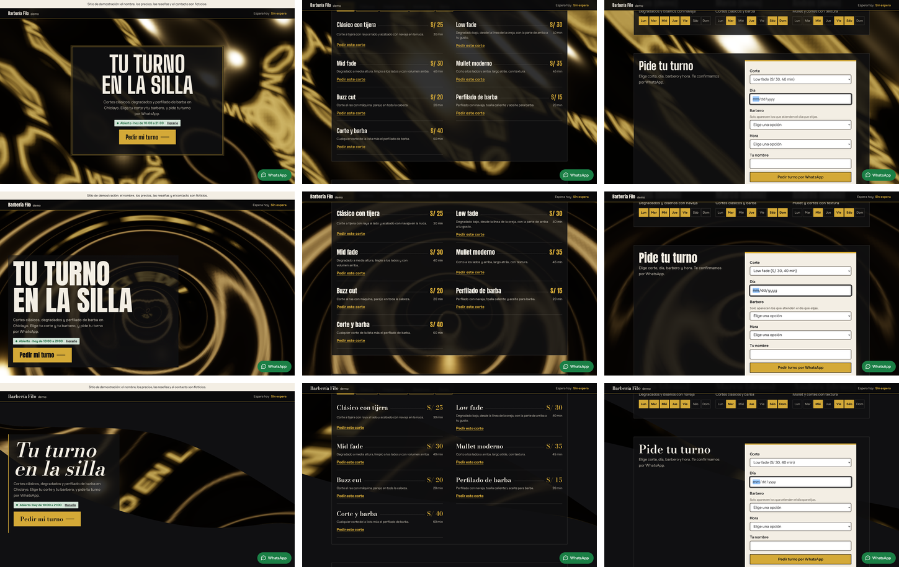
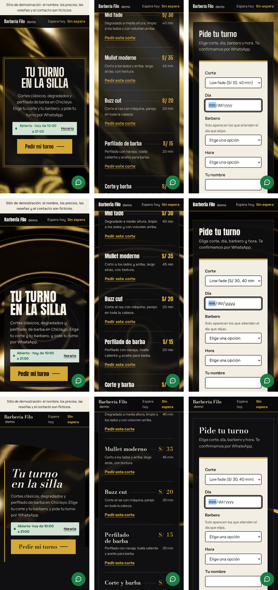
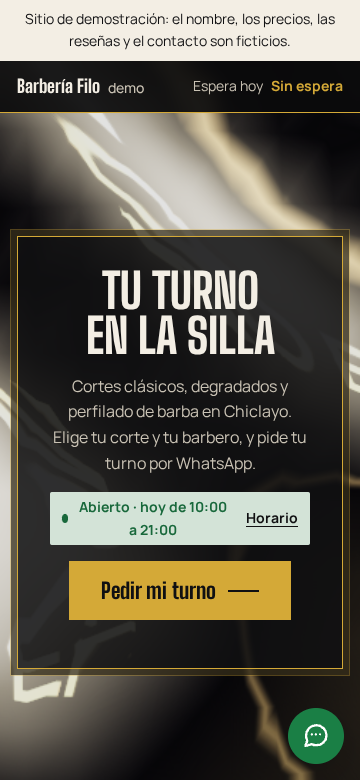
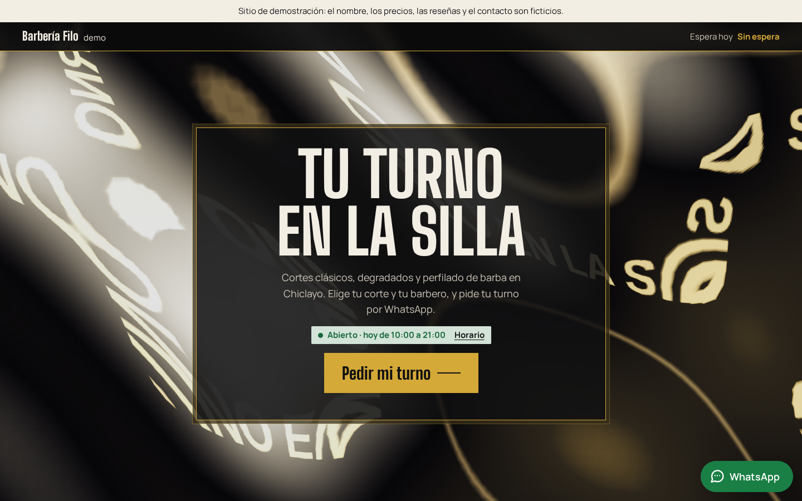
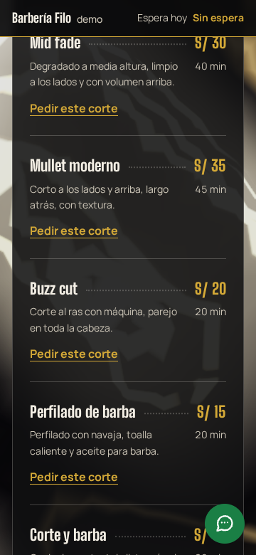
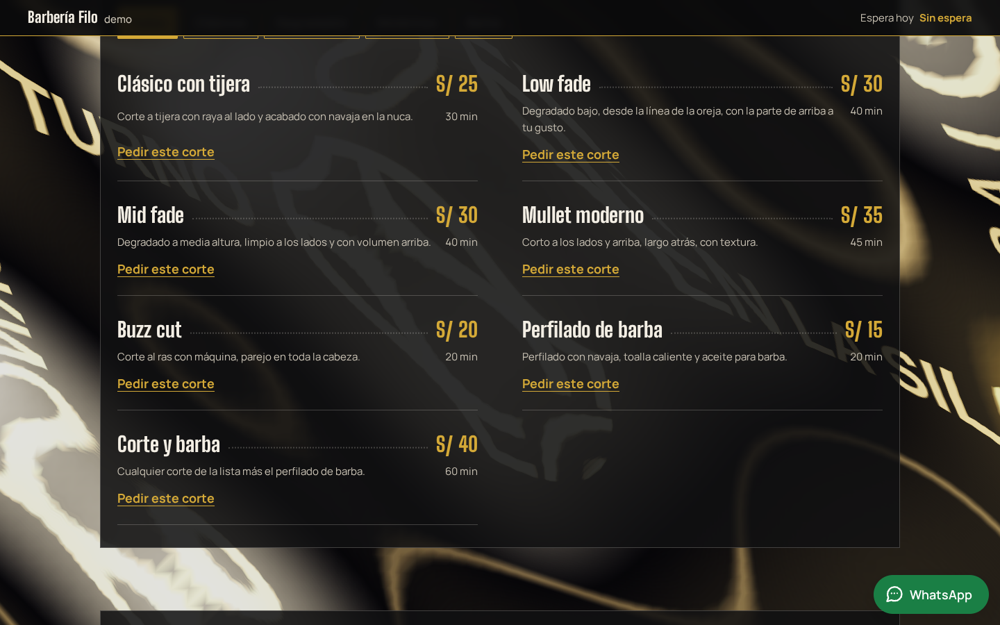
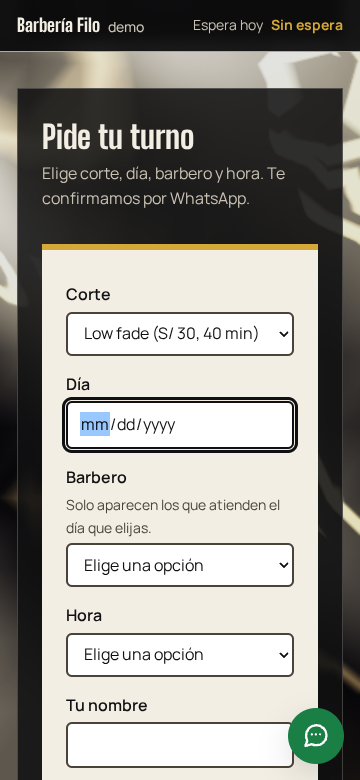
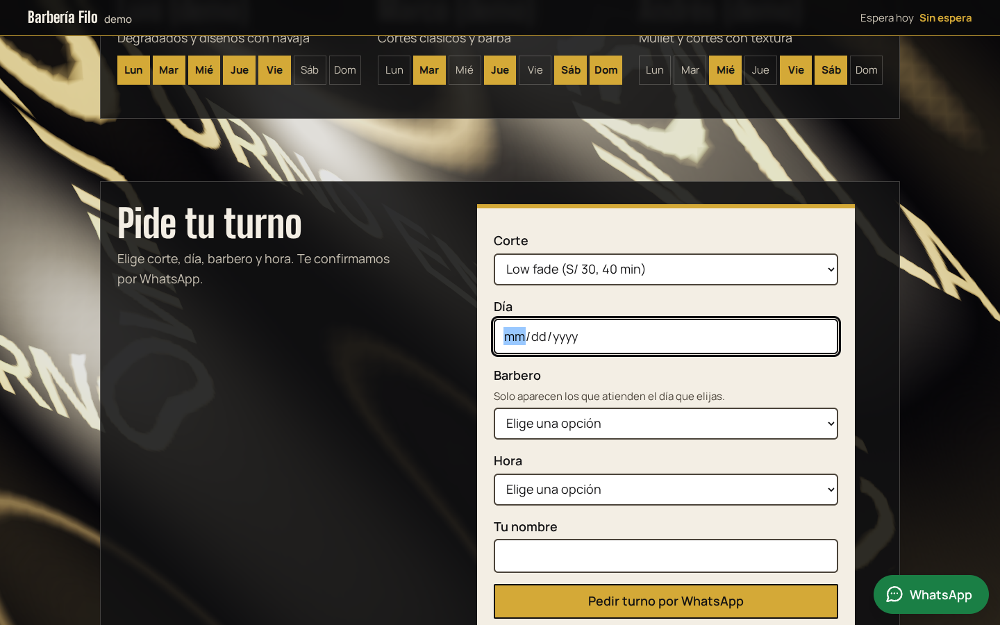

# Brief visual · Barbería · «Filo» («Barbería Filo · Demo»)

- **Estado:** pasos 1 a 6 hechos y construido en `barberia/`. **Dirección elegida: A «Espejo»** (modo autónomo; ver [docs/PROGRESO.md](../PROGRESO.md)).
- **Fecha:** 2026-10-27
- **Identidad** ([identidad.md](identidad.md)): «Filo».
  - Superficie de cromo líquido que se deforma con el scroll y refleja el titular, con un barrido de luz.
  - Componentes propios: el turno en la silla y el tiempo de espera siempre visible.
- **Función estrella:** «elige tu corte y tu barbero». Corte → día → barbero (solo los que atienden ese día) → hora → nombre, y el turno sale armado por WhatsApp.
- **Datos:** todos ficticios y marcados como demo: los barberos llevan «(demo)», las reseñas son de demostración y la dirección es la ficticia de las demos.

## Paso 1 · Referencias

**Webs del rubro.** Las barberías de referencia de la guía de nicho de `crear-web-como-servicio` repiten 3 cosas:

- reservar está a un toque;
- los precios están a la vista, en lista;
- el barbero tiene nombre y especialidad.

Lo que casi nunca muestran es el **tiempo de espera de hoy**, que es lo que más pregunta el cliente por WhatsApp. Aquí va fijo arriba.

**Inmersión.** Se toma la técnica de **Hubtown** (paso 1 del restaurante): el objeto brilla y la luz recorre su superficie. Aquí la superficie es el cromo y la luz es el barrido dorado.

**Estilo de 3D buscado:** metal líquido oscuro con reflejos cálidos, abstracto (sin sillas ni postes de barbero realistas, por la exigencia 3).

## Paso 2 · Tres direcciones con storyboard

**Cómo se hizo:** las 3 son variantes de la misma página real, con el contenido de `barberia/negocio.json` y el mismo cromo en 3 composiciones. Se capturaron con `npm run control -- barberia <a|b|c>`. Las variantes no elegidas ya no están en el código, pero sus capturas quedan aquí.

| Dirección      | Concepto                                                                | Escena                                           | Tipografía                                           |
| -------------- | ----------------------------------------------------------------------- | ------------------------------------------------ | ---------------------------------------------------- |
| **A · Espejo** | Una pared de cromo de frente; la portada es una placa grabada al centro | Cromo vertical que ondula y refleja el titular   | Big Shoulders Display (letrero condensado) + Manrope |
| **B · Charco** | El cromo en el suelo, visto desde arriba                                | Anillos que salen del centro, como agua de metal | Anton + Onest                                        |
| **C · Navaja** | Una cinta de cromo cruza la pantalla en diagonal y se tuerce            | El filo gira con el scroll                       | Bodoni Moda cursiva (moda) + Instrument Sans         |

| Dirección | Inicio · mitad · función estrella (1440 px)                    | 360 px                                                       |
| --------- | -------------------------------------------------------------- | ------------------------------------------------------------ |
| A, B y C  |  |  |

Cuadros sueltos: `control/barberia/a/`, `b/` y `c/`, con `1-inicio`, `2-mitad` y `3-estrella` a 360 y 1440 px.

### Control de exigencias de los storyboards

Las 3 variantes pasan lo medible a 360 y 1440 px. Los datos están en `control/barberia/<variante>/control.json`.

- **1:** en la primera pantalla aparecen el nombre (en el letrero), el titular, «Abierto · hoy de 10:00 a 21:00» con el enlace «Horario», y «Pedir mi turno».
- **2:** el titular «Tu turno en la silla» tiene 5 palabras y 2 líneas.
- **3:** la escena cubre el 100 % y está viva.
- **5:** cada variante usa una sola familia de titulares.

**El juicio** (exigencias 3 y 4, mirando las hojas):

- **A:** el cromo llena la pantalla y el titular se ve reflejado en él. La placa es un objeto del rubro (la placa grabada de una barbería), no un hero partido.
- **B:** es la más vistosa, pero sus ondas concéntricas se leen como agua.
- **C:** la cinta casi no se ve en celular y se lee como una forma abstracta.

### Elección

| Criterio (1 a 5)                                                                 | A · Espejo | B · Charco                            | C · Navaja |
| -------------------------------------------------------------------------------- | ---------- | ------------------------------------- | ---------- |
| Exigencias 1, 2 y 5 (medidas)                                                    | 5          | 5                                     | 5          |
| Exigencia 3: inmersión y «refleja el titular»                                    | 5          | 4                                     | 3          |
| Exigencia 4: componentes del rubro (placa, letrero de espera, tablero de turnos) | 5          | 4                                     | 4          |
| Identidad distinta de los otros rubros                                           | 5          | **2** (agua: es la identidad del spa) | 4          |
| Costo de rendimiento                                                             | 4          | 4                                     | 4          |
| **Total**                                                                        | **24**     | 19                                    | 20         |

**Elegida: A «Espejo».**

- **Cumple la identidad al pie de la letra:** el cromo refleja el titular.
- **B la descarté:** se lleva el «agua quieta» del spa.
- **C la descarté:** pierde fuerza en celular.

---

## Paso 3 · Sistema visual

- **Tema** (en `negocio.json`):
  - fondo `#101012`;
  - texto `#f3eee4` (16:1);
  - oro `#d4a937` (8.9:1 sobre el fondo, con texto oscuro encima).
- **Texto secundario:** `#c9c2b4` (10:1).
- **Placas:** son negras y translúcidas (`rgb(16 16 18 / 0.86)`). Todo el texto va sobre una placa, nunca directo sobre el cromo.
- **Superficies claras:** el turno y el estado van en papel claro `#f3eee4`, donde el verde y el rojo del estado y los campos del formulario se leen con su contraste normal.
- **Tipografía:**
  - Big Shoulders Display, 700–900, con respaldo Arial Narrow ajustado: 17 KB.
  - Manrope, 400–700, con respaldo ajustado: 17 KB.
  - Las dos se recortan al español con `npm run fuentes`.
- **Forma:** radios de 2 px (placas metálicas, no píldoras) y bordes de 1 px de oro o de crema translúcido.

## Paso 4 · Guion de movimiento

Ritmo de la identidad: **cortes secos, como un filo**. Duraciones cortas y curvas que frenan en seco (`expo.out`).

| Elemento                                                                                           | Disparador               | Duración y curva                         | Movimiento reducido          |
| -------------------------------------------------------------------------------------------------- | ------------------------ | ---------------------------------------- | ---------------------------- |
| El cromo ondula y las ondas viajan y se calman                                                     | scroll hasta el turno    | ligado al scroll                         | sin 3D: queda la imagen fija |
| Barrido de luz dorada (la captura del cromo gira)                                                  | scroll                   | ligado al scroll                         | no ocurre                    |
| Títulos que entran de un tajo, palabra por palabra (GSAP)                                          | el título entra al 85 %  | 320 ms, 50 ms entre palabras, `expo.out` | sin animación                |
| La lista de cortes se recorta línea por línea, como una navaja (GSAP)                              | la lista entra al 80 %   | 400 ms, 60 ms entre líneas, `power4.out` | sin animación                |
| Los días de cada barbero caen en su casilla (GSAP, con escala y no con opacidad, por el contraste) | el tablero entra al 80 % | 250 ms, 40 ms, `back.out(3)`             | sin animación                |
| «Pedir mi turno» se corre 4 px                                                                     | hover con mouse          | 160 ms, `expo.out`                       | sin animación                |

**Carga del 3D (ADR 008):**

1. Imagen fija `img/filo-*.webp` (de 11 a 26 KB), en encuadre horizontal y vertical.
2. Three.js y GSAP llegan con `import()` cuando la página está libre (`core/escena-cliente.js`).
3. Nada de eso llega con movimiento reducido, ahorro de datos, poca memoria o sin WebGL2.

## Paso 5 · Hero vivo (la página construida)

- **Videos:**
  - [recorrido-360.mp4](control/barberia/recorrido-360.mp4)
  - [recorrido-1440.mp4](control/barberia/recorrido-1440.mp4)
- **Verla en el navegador:** en la terminal de Ubuntu, `npm run build && npm run preview`; luego abre http://localhost:4173/prototipos-web-chiclayo/barberia/.

| Cuadro               | 360 px                                   | 1440 px                                   |
| -------------------- | ---------------------------------------- | ----------------------------------------- |
| 1 · Inicio           |    |    |
| 2 · Mitad del scroll |     |     |
| 3 · Función estrella |  |  |

## Paso 6 · Revisión, Control final y medición

**Correcciones de la revisión y de las pruebas:**

- **Los días de cada barbero entraban con opacidad 0.15:** hasta que el scroll llegaba, el texto quedaba tenue y Axe lo marcó por contraste. Ahora entran con escala.
- **Las pruebas congelaban el reloj:** las coreografías se quedaban en su primer cuadro (la lista de cortes, recortada). Ahora el reloj empieza en martes 13:00 y sigue corriendo (`pruebas/teclado/ayudas.js`).
- **El cromo con material físico y mapa de entorno (PMREM) dejaba móvil en 70:** se cambió por un matcap (la captura del cromo con el titular), con una malla más gruesa y el canvas al 70 % en celular.

**Control final** (`npm run control -- barberia`): pasa a 360 y 1440 px en las exigencias 1, 2, 3 y 5. La 4 se juzga con la captura:

- **Componentes del rubro:** la placa grabada, el letrero con la espera de hoy, el tablero de turnos de los barberos y el turno.
- **Lo que no aparece:** hero partido, par de botones y grilla de 3 tarjetas iguales. Los barberos van en 3 columnas, pero cada uno es un tablero de 7 días, no una tarjeta genérica.

**Pruebas:**

- **`test:teclado`:** el tab inicial, «Pedir este corte», el filtro de barberos por día, el turno completo con el mensaje literal de WhatsApp y los filtros de cortes, más el estado de horario en 2 horas.
- **Axe:** 0 violaciones.

**Lighthouse 12** (build + preview, mediana de 5):

|            | Rendimiento | Accesibilidad | Buenas prácticas | SEO | LCP    | CLS   | TBT    |
| ---------- | ----------- | ------------- | ---------------- | --- | ------ | ----- | ------ |
| Móvil      | **86**      | 100           | 100              | 100 | 1.22 s | 0.017 | 544 ms |
| Escritorio | 98          | 100           | 100              | 100 | 0.34 s | 0.002 | 128 ms |

Móvil queda entre 85 y 89 y se acepta (ADR 008).
