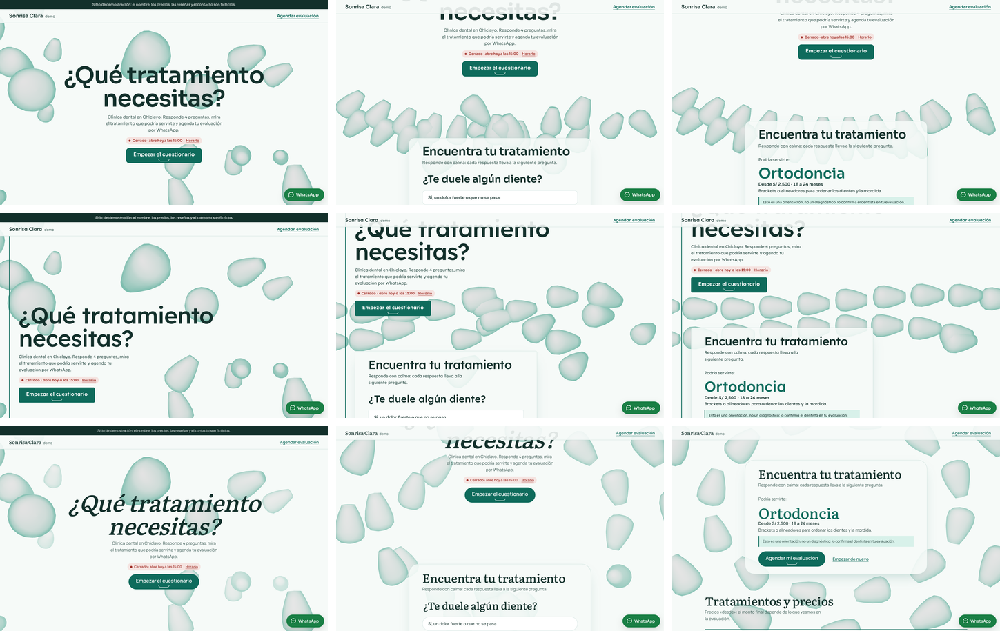
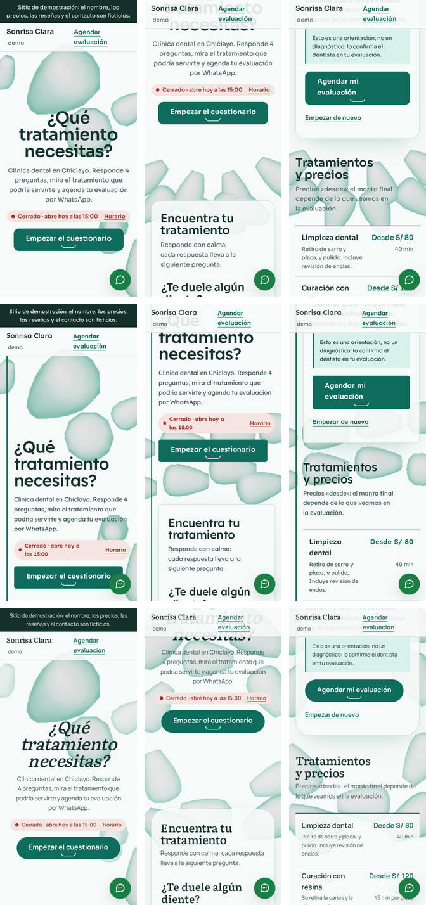
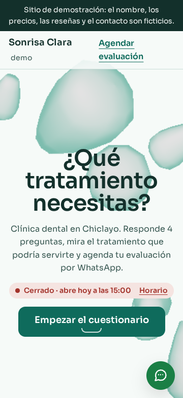
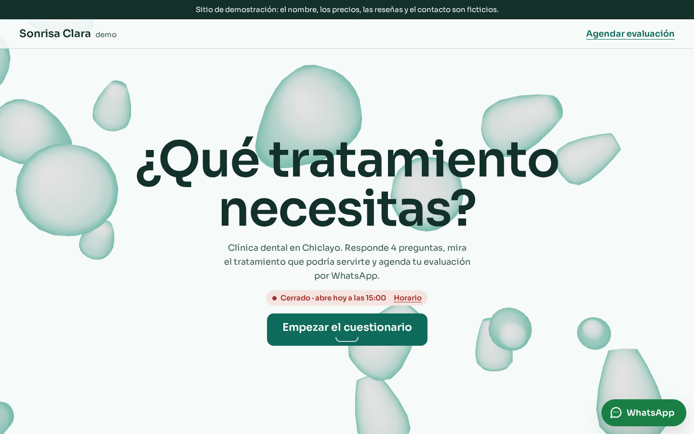
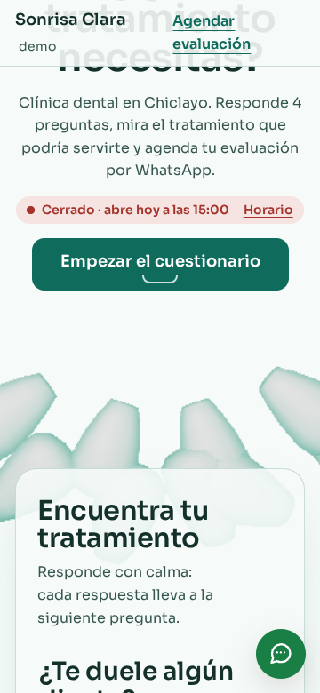
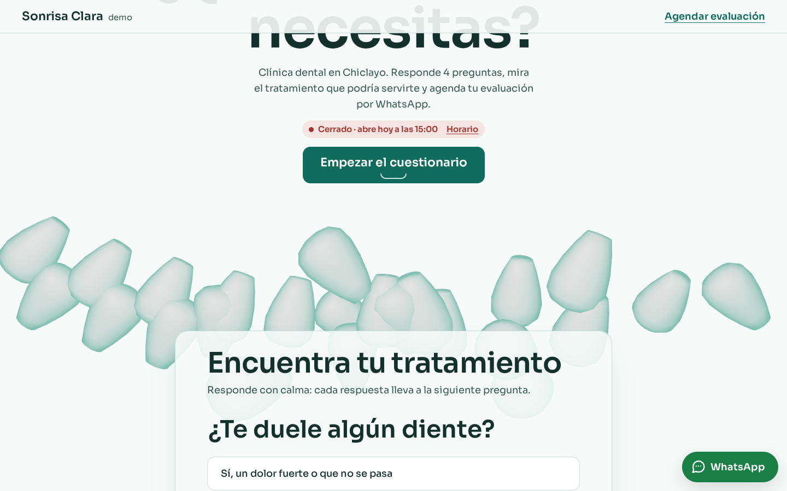
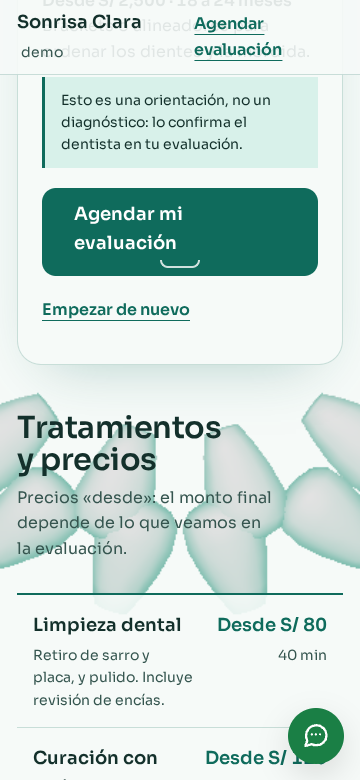
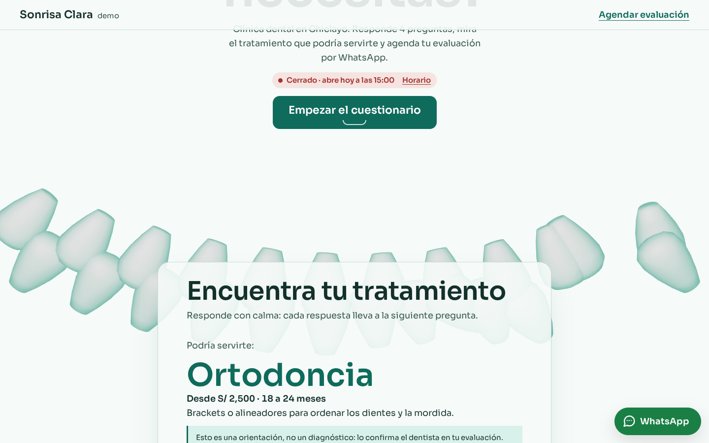

# Brief visual · Clínica dental · «Calma clínica» («Sonrisa Clara · Demo»)

- **Estado:** pasos 1 a 6 hechos y construido en `dental/`. **Dirección elegida: A «Arco»** (modo autónomo; ver [docs/PROGRESO.md](../PROGRESO.md)).
- **Fecha:** 2026-10-27
- **Identidad** ([identidad.md](identidad.md)): «Calma clínica».
  - Formas de vidrio esmerilado que se alinean poco a poco con el scroll, como una sonrisa que se ordena.
  - Componentes propios: el cuestionario como recorrido y los precios «desde» con duración.
- **Función estrella:** «¿Qué tratamiento necesito?». Una pregunta a la vez; cada respuesta lleva a la siguiente o a un tratamiento que podría servir. El resultado queda escrito en la cita de evaluación, que sale por WhatsApp.
- **Datos:** todos ficticios y marcados como demo:
  - el equipo lleva «COP 00000 (demo)» en lugar de una colegiatura;
  - las reseñas son de demostración;
  - la dirección es la ficticia de las demos.

## Paso 1 · Referencias

**Webs del rubro.** Las clínicas dentales repiten 3 cosas:

- un botón de «agenda tu cita»;
- una lista de tratamientos, casi siempre sin precio;
- fotos de antes y después.

Lo que el paciente pregunta por WhatsApp antes de ir es **qué tratamiento necesita y cuánto cuesta más o menos**. Por eso el cuestionario va primero y los precios «desde» van a la vista, con su duración.

**Lo que no se hace:**

- **No hay antes y después.** Con datos de demo sería fabricar resultados, y una clínica real los necesita con permiso del paciente.
- **El cuestionario orienta, no diagnostica.** Lo dice en el resultado, y en las preguntas frecuentes.
- **No hay colegiaturas inventadas.** El número COP es «00000 (demo)».

**Inmersión.** Se toma la idea de los objetos que **se ordenan con el scroll** (la técnica del restaurante «El pase»), pero en otro material: vidrio claro en vez de cerámica mate, y una sonrisa en vez de una carta.

**Estilo de 3D buscado:** piezas abstractas de vidrio esmerilado menta, claras sobre un campo claro. Se leen como dientes sin ser una ilustración dental realista (exigencia 3).

## Paso 2 · Tres direcciones con storyboard

**Cómo se hizo:** las 3 son variantes de la misma página real, con el contenido de `dental/negocio.json` y las mismas piezas en 3 composiciones finales. Se capturaron con `npm run control -- dental <a|b|c>`. Las variantes no elegidas ya no están en el código, pero sus capturas quedan aquí.

| Dirección       | Concepto                                                            | Escena                                            | Tipografía                               |
| --------------- | ------------------------------------------------------------------- | ------------------------------------------------- | ---------------------------------------- |
| **A · Arco**    | Todo al centro; las piezas se cierran en una sonrisa bajo el título | Dos arcadas que se ordenan en curva               | Sora (geométrica, suave) en todo         |
| **B · Columna** | Una sola columna a la izquierda con una regla menta que la recorre  | Las piezas pasan a una fila que cruza la pantalla | Lexend (pensada para leer fácil) en todo |
| **C · Bruma**   | Titulares con serifa cursiva; todo flota dentro de un anillo        | Anillo grande y lento, con niebla                 | Literata cursiva + Manrope               |

| Dirección | Inicio · mitad · función estrella (1440 px)                  | 360 px                                                     |
| --------- | ------------------------------------------------------------ | ---------------------------------------------------------- |
| A, B y C  |  |  |

Cuadros sueltos: `control/dental/a/`, `b/` y `c/`, con `1-inicio`, `2-mitad` y `3-estrella` a 360 y 1440 px.

### Control de exigencias de los storyboards

**Primera medición:**

- **Falló la exigencia 2 en B y C:** el titular salía en 3 líneas a 1440 px.
- **Corrección:** se dio más ancho al titular (15 y 17 caracteres). Al medir otra vez, las 3 pasan a 360 y 1440 px. Los datos están en `control/dental/<variante>/control.json`.

**Qué se midió en cada exigencia:**

- **1:** en la primera pantalla aparecen el nombre (en la cabecera), el titular, «Cerrado · abre hoy a las 15:00» (martes 13:00, la pausa del mediodía) con el enlace «Horario», y «Empezar el cuestionario».
- **2:** el titular «¿Qué tratamiento necesitas?» tiene 3 palabras. Ocupa 2 líneas en escritorio y 3 en celular. Los títulos de sección tienen 5 palabras o menos.
- **3:** la escena cubre el 100 % y está viva.
- **5:** cada variante usa una sola familia de titulares.

**Una corrección antes de comparar:**

- **Problema:** las primeras piezas eran cápsulas y se leían como pastillas (farmacia, no clínica dental).
- **Cambio:** se cambiaron por un perfil torneado, con corona redonda y raíz corta.

**El juicio** (exigencias 3 y 4, mirando las hojas):

- **A:** a mitad del scroll, la fila de piezas se curva en una sonrisa. Es la metáfora de la identidad, literal y legible a 360 px.
- **B:** la fila se lee como una hilera de dientes, pero recta. La regla lateral y el texto a la izquierda acercan la portada a un documento.
- **C:** el anillo es elegante y envuelve el cuestionario, pero la cursiva con serifa se acerca al restaurante (Fraunces) y la niebla agrega costo.

### Elección

| Criterio (1 a 5)                                                                  | A · Arco | B · Columna | C · Bruma                                   |
| --------------------------------------------------------------------------------- | -------- | ----------- | ------------------------------------------- |
| Exigencias 1, 2 y 5 (medidas)                                                     | 5        | 5           | 5                                           |
| Exigencia 3: inmersión y «una sonrisa que se ordena»                              | 5        | 3           | 4                                           |
| Exigencia 4: componentes del rubro (cuestionario como recorrido, precios «desde») | 5        | 4           | 5                                           |
| Identidad distinta de los otros rubros                                            | 4        | 4           | **3** (serifa cursiva, como el restaurante) |
| Costo de rendimiento                                                              | 5        | 5           | 4 (niebla)                                  |
| **Total**                                                                         | **24**   | 21          | 21                                          |

**Elegida: A «Arco».**

- **Cumple la identidad al pie de la letra:** la sonrisa se ordena con el scroll.
- **Se diferencia de la barbería:** la barbería también centra la portada, pero en una placa oscura sobre cromo. Aquí no hay placa: el titular flota directo sobre el campo claro.
- **B la descarté:** la fila recta pierde la sonrisa.
- **C la descarté:** su tipografía se parece al restaurante y la niebla cuesta más.

---

## Paso 3 · Sistema visual

- **Tema** (en `negocio.json`):
  - fondo `#f6faf8`;
  - texto `#13302b` (13:1);
  - marca `#0f6b5c` (6.1:1 sobre el fondo; el texto blanco encima, 6.4:1);
  - menta `#d8f1ea` (avisos y respuestas al pasar el mouse).
- **Texto secundario:** `#35554f` (7.8:1).
- **Láminas de vidrio:** `rgb(246 250 248 / 0.88)` con borde menta de 1 px y una sombra verde muy suave. Son casi opacas: el texto nunca queda directo sobre una pieza.
- **Tipografía:** Sora, 400–600, recortada al español con `npm run fuentes`: 16 KB, con respaldo Arial ajustado. Una sola familia para titulares y texto.
- **Forma:**
  - láminas con radio de 24 px;
  - botones con radio de 14 px;
  - el sello de la colegiatura, en píldora.
- **El llamado:** una lámina sólida color marca con una curva de sonrisa dibujada bajo el texto. No es un par de botones ni una píldora.

## Paso 4 · Guion de movimiento

Ritmo de la identidad: **lento y suave, nada salta**. Duraciones largas y curvas que se posan (`sine.out`, `cubic-bezier(0.37, 0, 0.13, 1)`).

| Elemento                                                                                | Disparador                   | Duración y curva                      | Movimiento reducido          |
| --------------------------------------------------------------------------------------- | ---------------------------- | ------------------------------------- | ---------------------------- |
| Las piezas sueltas se ordenan en dos arcadas (una sonrisa)                              | scroll hasta el cuestionario | ligado al scroll, con inercia         | sin 3D: queda la imagen fija |
| Cambio de pregunta del cuestionario (View Transition: la anterior sube, la nueva llega) | elegir una respuesta         | 420 ms, curva «calma»                 | cambio sin animación         |
| Títulos de sección que suben 28 px (GSAP, con desplazamiento y no con opacidad)         | el título entra al 88 %      | 900 ms, `sine.out`                    | sin animación                |
| La lista de precios se ordena fila por fila (GSAP)                                      | la lista entra al 82 %       | 700 ms, 80 ms entre filas, `sine.out` | sin animación                |
| «Empezar el cuestionario» sube 2 px                                                     | hover con mouse              | 300 ms, curva «calma»                 | sin animación                |

**Carga del 3D (ADR 008):**

1. Imagen fija `img/calma-*.webp` (de 7 a 14 KB), en encuadre horizontal y vertical.
2. Three.js y GSAP llegan con `import()` cuando la página está libre (`core/escena-cliente.js`).
3. Nada de eso llega con movimiento reducido, ahorro de datos, poca memoria o sin WebGL2.

**Material:** matcap, como el cromo de la barbería. Es una imagen clara con el borde menta, sin luces ni transparencias. Hay 24 piezas (12 en celular) y en celular la pieza tiene menos caras.

## Paso 5 · Hero vivo (la página construida)

- **Videos:**
  - [recorrido-360.mp4](control/dental/recorrido-360.mp4)
  - [recorrido-1440.mp4](control/dental/recorrido-1440.mp4)
- **Verla en el navegador:** en la terminal de Ubuntu, `npm run build && npm run preview`; luego abre http://localhost:4173/prototipos-web-chiclayo/dental/.

| Cuadro               | 360 px                                 | 1440 px                                 |
| -------------------- | -------------------------------------- | --------------------------------------- |
| 1 · Inicio           |    |    |
| 2 · Mitad del scroll |     |     |
| 3 · Función estrella |  |  |

## Paso 6 · Revisión, Control final y medición

**Correcciones de la revisión y de las pruebas:**

- **Las respuestas eran radios:** con el teclado, las flechas cambian de radio y el cuestionario habría avanzado sin querer. Ahora cada respuesta es un botón.
- **El foco no llegaba a la pregunta nueva:** la prueba de teclado lo encontró. Con View Transition, el navegador actualiza la página un instante después, y el foco se pedía antes de que la pregunta se mostrara. Ahora el foco se mueve dentro de la actualización.
- **La sonrisa se terminaba de formar tarde:** cuando el cuestionario ya estaba arriba. Ahora termina un poco antes.

**Control final** (`npm run control -- dental`): pasa a 360 y 1440 px en las exigencias 1, 2, 3 y 5. La 4 se juzga con la captura:

- **Componentes del rubro:**
  - el cuestionario, una pregunta a la vez;
  - la tabla de precios «desde» con duración;
  - el sello de colegiatura del equipo;
  - la cita de evaluación con el resultado del cuestionario.
- **Lo que no aparece:**
  - hero partido;
  - par de botones;
  - grilla de 3 tarjetas iguales.
- **El ritmo cambia de sección en sección:**
  - lámina ancha (cuestionario);
  - tabla a todo el ancho (precios);
  - lista en línea (equipo);
  - lámina en 2 columnas (cita);
  - lámina angosta (preguntas).

**Pruebas:**

- **`test:teclado`:**
  - el tab inicial;
  - el cuestionario completo con el foco en cada pregunta, con «Volver» y Escape;
  - la cita con el error y el mensaje literal de WhatsApp;
  - «Empezar de nuevo»;
  - el estado de horario en 3 horas: abierto, en la pausa del mediodía y domingo.
- **Axe:** 0 violaciones.

**Lighthouse 12** (build + preview, mediana de 5):

|            | Rendimiento | Accesibilidad | Buenas prácticas | SEO | LCP    | CLS   | TBT    |
| ---------- | ----------- | ------------- | ---------------- | --- | ------ | ----- | ------ |
| Móvil      | **93**      | 100           | 100              | 100 | 1.21 s | 0.000 | 322 ms |
| Escritorio | 100         | 100           | 100              | 100 | 0.30 s | 0.000 | 33 ms  |

Dentro del presupuesto del ADR 008, sin excepción.
