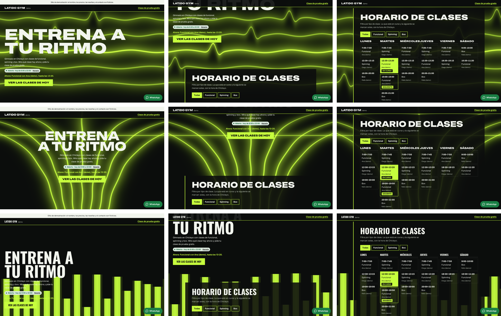
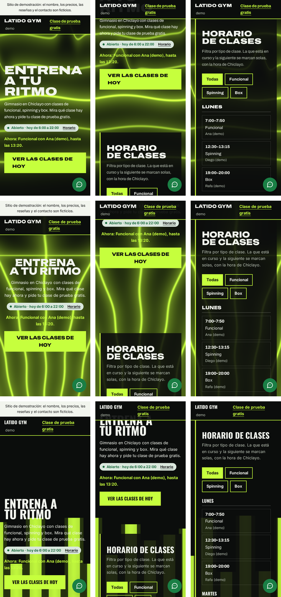
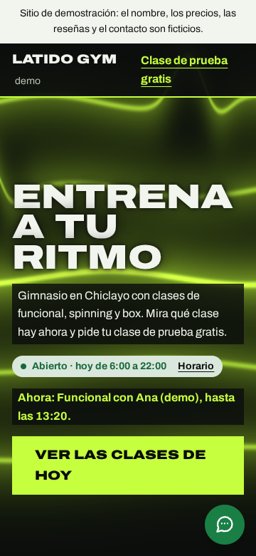
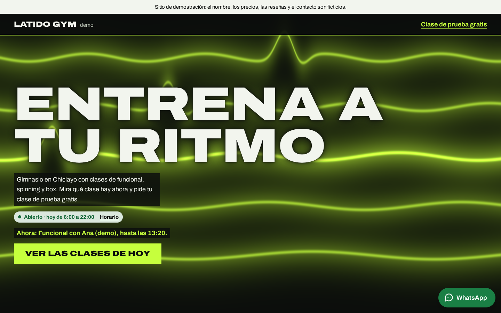
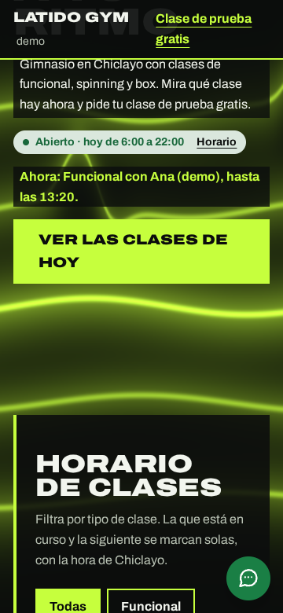
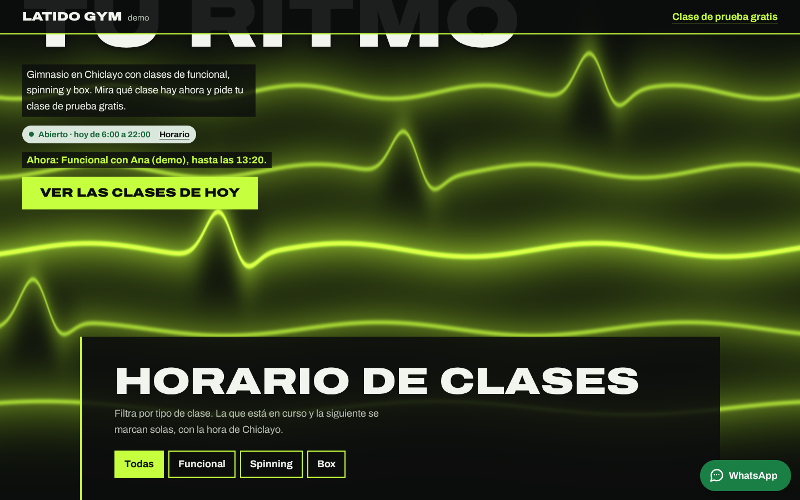
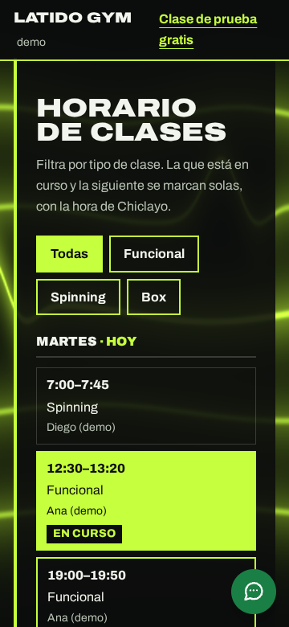
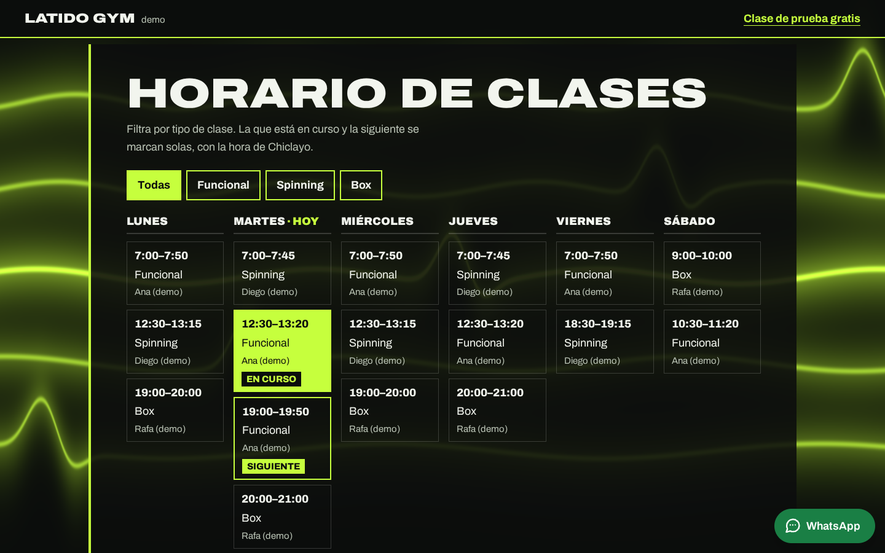

# Brief visual · Gimnasio · «Pulso» («Latido Gym · Demo»)

- **Estado:** pasos 1 a 6 hechos y construido en `gimnasio/`. **Dirección elegida: A «Monitor»** (modo autónomo; ver [docs/PROGRESO.md](../PROGRESO.md)).
- **Fecha:** 2026-10-27
- **Nombre de demo:** «Latido». Una búsqueda web no mostró ningún gimnasio con ese nombre en Chiclayo. Conviene confirmarlo en Google Maps antes de mostrarlo a un prospecto.
- **Identidad** ([identidad.md](identidad.md)): «Pulso».
  - Ondas de luz que responden a la velocidad del scroll, con tipografía cinética.
  - Componentes propios: el horario de clases con «en curso» en vivo y la cuenta regresiva de la promoción.
- **Función estrella:** el horario semanal de clases.
  - Se filtra por tipo.
  - Con la hora de Lima marca la clase **en curso** y la **siguiente**.
  - La portada dice cuál es («Ahora: Funcional con Ana (demo), hasta las 13:20.»).
- **Datos:** todos ficticios y marcados como demo:
  - los entrenadores llevan «(demo)»;
  - la promoción dice «Promoción de demostración»;
  - las reseñas son de demostración.

## Paso 1 · Referencias

**Lo que resuelve la página.**

- **Qué falta revisar:** este paso no revisó las webs de los prospectos del plan (World Light SUMA, New Power Gym, Gym Max). Queda pendiente antes de mostrarles la demo.
- **Qué pide el plan:** motivar, mostrar planes y horarios de clases sin tener que preguntar, y conseguir que agenden una clase de prueba.
- **Cómo lo resuelve la página:** la pregunta «¿qué clase hay ahora?» se responde en la primera pantalla.

**Lo que no se hace:**

- **No hay «gente entrenando» en fotos:** el plan lo menciona, pero serían fotos de stock de personas en un negocio que no es el suyo. La energía la da la escena.
- **El IMC es una referencia:** dice que no es un diagnóstico y nombra la fuente (OMS).
- **La urgencia de la promoción va marcada:** está etiquetada «de demostración» y desaparece sola al pasar la fecha de fin.

**Inmersión:**

- **Qué se toma:** del agua del spa, un plano con shader propio.
- **Qué cambia:** el ritmo. Aquí manda la **velocidad** del scroll, no la posición: quieto es apenas un latido, bajando rápido las líneas se agitan, y al soltar se calman.
- **La tipografía también se mueve:** los titulares se inclinan con la velocidad (GSAP `getVelocity`) y vuelven a su sitio.

## Paso 2 · Tres direcciones con storyboard

**Cómo se hizo:** las 3 son variantes de la misma página real, con el contenido de `gimnasio/negocio.json` y el mismo shader en 3 modos. Se capturaron con `npm run control -- gimnasio <a|b|c>`. Las variantes no elegidas ya no están en el código, pero sus capturas quedan aquí.

| Dirección           | Concepto                                                    | Escena                                       | Tipografía                        |
| ------------------- | ----------------------------------------------------------- | -------------------------------------------- | --------------------------------- |
| **A · Monitor**     | Titular expandido a la izquierda, sobre un monitor cardíaco | 5 líneas con un latido de electrocardiograma | Archivo expandida (125 %) en todo |
| **B · Pista**       | Titular al centro, sobre el horizonte                       | Carriles que se juntan en el horizonte       | Unbounded + Inter                 |
| **C · Ecualizador** | Titular abajo a la izquierda                                | Barras verticales que suben con la velocidad | Oswald + Inter                    |

| Dirección | Inicio · mitad · horario de clases (1440 px)                   | 360 px                                                       |
| --------- | -------------------------------------------------------------- | ------------------------------------------------------------ |
| A, B y C  |  |  |

Cuadros sueltos: `control/gimnasio/a/`, `b/` y `c/`, con `1-inicio`, `2-mitad` y `3-estrella` a 360 y 1440 px.

### Control de exigencias de los storyboards

Las 3 variantes pasan lo medible a 360 y 1440 px. Los datos están en `control/gimnasio/<variante>/control.json`.

**Qué se midió en cada exigencia:**

- **1:** en la primera pantalla aparecen:
  - el nombre (en la cabecera);
  - el titular;
  - «Abierto · hoy de 6:00 a 22:00» con el enlace «Horario»;
  - «Ver las clases de hoy».
- **2:** el titular «Entrena a tu ritmo» tiene 4 palabras. Los títulos de sección tienen 5 palabras o menos.
- **3:** la escena cubre el 100 % y está viva.
- **5:** cada variante usa una sola familia de titulares.

**Lo que se vio en las hojas y se corrigió:**

- **El texto chico sobre las líneas de luz:** en las 3, el texto blanco perdía contraste donde una línea neón le pasaba por detrás.
  - La bajada y la línea «Ahora» van sobre una franja oscura.
  - El titular lleva una sombra oscura.
- **Los días del horario a 1440 px:** «MIÉRCOLES» chocaba con «JUEVES». Los nombres de los días ahora van en ancho normal.

**El juicio** (exigencias 3 y 4, mirando las hojas):

- **A:** el electrocardiograma es «Pulso» al pie de la letra, y el titular expandido llena la pantalla.
- **B:** la pista se ve espectacular, pero vuelve a centrar la portada y se lee como un estadio.
- **C:** las barras del ecualizador tapan la bajada en celular y se leen como música, no como gimnasio.

### Elección

| Criterio (1 a 5)                                                      | A · Monitor | B · Pista            | C · Ecualizador        |
| --------------------------------------------------------------------- | ----------- | -------------------- | ---------------------- |
| Exigencias 1, 2 y 5 (medidas)                                         | 5           | 5                    | 5                      |
| Exigencia 3: ondas de luz con la velocidad del scroll                 | 5           | 5                    | 3 (tapa el texto)      |
| Exigencia 4: componentes del rubro (clase en curso, cuenta regresiva) | 5           | 5                    | 5                      |
| Identidad distinta de los otros rubros                                | 5           | 3 (portada centrada) | 3 (se lee como música) |
| Costo de rendimiento                                                  | 4           | 4                    | 5                      |
| **Total**                                                             | **24**      | 22                   | 21                     |

**Elegida: A «Monitor».**

- **B la descarté:** espectacular, pero repetía la portada centrada.
- **C la descarté:** se lee como un ecualizador de música.

---

## Paso 3 · Sistema visual

- **Tema** (en `negocio.json`):
  - fondo `#0b0d0c`;
  - texto `#f2f5ee` (17.7:1);
  - verde lima neón `#c6ff3d` (16.5:1 sobre el fondo; el texto negro encima).
- **Texto secundario:** `#b9c2b4` (10:1).
- **Errores de formulario:** el rojo del núcleo no se lee sobre negro. Aquí van en `#ff8f87` (8.9:1).
- **Estado de horario:** en una ficha clara, donde el verde y el rojo del núcleo se leen con su contraste normal (como en la barbería).
- **Placas:** negras translúcidas, con un filo neón de 4 px a la izquierda.
- **La franja de la promoción:** a todo el ancho, en neón con texto negro, corta el ritmo de las placas.
- **Tipografía:** Archivo, 400–900, con su eje de ancho.
  - Los titulares van en mayúsculas, peso 900 y expandidos al 125 %.
  - Recortada al español: 39 KB, precargada.
- **Forma:**
  - radios de 0 (todo es recto, como placas de gimnasio);
  - el llamado es una barra neón recta.

## Paso 4 · Guion de movimiento

Ritmo de la identidad: **golpes cortos y enérgicos, como un tren de intervalos**.

| Elemento                                                      | Disparador               | Duración y curva                        | Movimiento reducido          |
| ------------------------------------------------------------- | ------------------------ | --------------------------------------- | ---------------------------- |
| Las líneas se agitan con la velocidad y laten como un monitor | velocidad del scroll     | ligado al scroll, con inercia           | sin 3D: queda la imagen fija |
| Los titulares se inclinan con la velocidad (GSAP, `skewX`)    | velocidad del scroll     | 350 ms, `power3.out`; vuelven al soltar | sin animación                |
| Los días del horario entran de golpe, uno tras otro (GSAP)    | el horario entra al 85 % | 350 ms, 60 ms entre días, `power4.out`  | sin animación                |
| El ahorro de cada plan salta (GSAP, escala)                   | la tabla entra al 80 %   | 350 ms, 100 ms, `back.out(3)`           | sin animación                |
| «Ver las clases de hoy» se corre 6 px                         | hover con mouse          | 150 ms, `ease-out`                      | sin animación                |

**Carga del 3D (ADR 008):**

1. Imagen fija `img/pulso-*.webp` (de 10 a 20 KB), en encuadre horizontal y vertical.
2. Three.js y GSAP llegan con `import()` cuando la página está libre.
3. Nada de eso llega con movimiento reducido, ahorro de datos, poca memoria o sin WebGL2.

**Escena:**

- Es un solo plano con shader: 5 líneas por píxel, sin texturas.
- La velocidad se calcula con lo que avanzó el scroll entre un cuadro y otro.
- Al soltar, el avance se frena solo y el pulso se calma antes de que la escena deje de dibujar.

## Paso 5 · Hero vivo (la página construida)

- **Videos:**
  - [recorrido-360.mp4](control/gimnasio/recorrido-360.mp4)
  - [recorrido-1440.mp4](control/gimnasio/recorrido-1440.mp4)
- **Verla en el navegador:** en la terminal de Ubuntu, `npm run build && npm run preview`; luego abre http://localhost:4173/prototipos-web-chiclayo/gimnasio/.

| Cuadro               | 360 px                                   | 1440 px                                   |
| -------------------- | ---------------------------------------- | ----------------------------------------- |
| 1 · Inicio           |    |    |
| 2 · Mitad del scroll |     |     |
| 3 · Función estrella |  |  |

## Paso 6 · Revisión, Control final y medición

**Correcciones de la revisión y de las pruebas:**

- **La fecha de fin de la promoción** salía «a las 11:59 p. m..», con doble punto y en formato de 12 horas. Ahora dice «a las 23:59.».
- **El IMC mezclaba separadores:** escribía «22.9» (así formatea `es-PE`) junto a rangos con coma («18,5»). Ahora todo va con punto, como se escribe en Perú.
- **En celular, el horario empezaba en lunes aunque fuera martes:** ahora el día de hoy va primero y dice «· hoy».

**Control final** (`npm run control -- gimnasio`): pasa a 360 y 1440 px en las exigencias 1, 2, 3 y 5. La 4 se juzga con la captura:

- **Componentes del rubro:**
  - el horario semanal con la clase en curso encendida y la siguiente marcada;
  - la cuenta regresiva;
  - la tabla de planes con su ahorro;
  - la calculadora de IMC.
- **Lo que no aparece:**
  - hero partido;
  - par de botones;
  - grilla de 3 tarjetas iguales. Los planes van en una tabla de comparación.

**Pruebas:**

- **`test:teclado`:**
  - el tab inicial;
  - la clase en curso y la siguiente (martes 13:00), con la frase de la portada;
  - el filtro «Box», que cambia la siguiente clase;
  - la cuenta regresiva;
  - el IMC con su error y su resultado;
  - la clase de prueba con el mensaje literal de WhatsApp;
  - el estado de horario en 2 horas.
- **Axe:** 0 violaciones.

**Lighthouse 12** (build + preview, mediana de 5):

|            | Rendimiento | Accesibilidad | Buenas prácticas | SEO | LCP    | CLS   | TBT    |
| ---------- | ----------- | ------------- | ---------------- | --- | ------ | ----- | ------ |
| Móvil      | **91**      | 100           | 100              | 100 | 1.51 s | 0.007 | 371 ms |
| Escritorio | 98          | 100           | 100              | 100 | 0.37 s | 0.000 | 125 ms |

Dentro del presupuesto del ADR 008, sin excepción.
