# Brief visual · Restaurante v2 · «La cocina abierta» («Sabores del Norte · Demo»)

- **Estado:** paso 2 hecho. **Dirección elegida: C «El pase»** (modo autónomo; ver [docs/PROGRESO.md](../PROGRESO.md)). Siguen los pasos 3 a 6.
- **Fecha:** 2026-10-26
- **Identidad:** «La cocina abierta» ([identidad.md](identidad.md)).
  - Ingredientes del norte en 3D mate a pantalla completa que, al bajar, se ordenan en las categorías de la carta.
  - Componentes propios: carta como comanda que se imprime; horario y menú del día en pizarra.
- **Antecedente:** la ronda 1, [«La olla manda»](restaurante-inmersivo.md), no se aprobó. Sus 4 motivos se volvieron las _Exigencias de diseño_ (ADR 009).
- **Se conserva:**
  - la imagen fija liviana como LCP (ADR 008);
  - la lógica del sitio v1 (carrito, comanda, reservas, pruebas);
  - las herramientas: `npm run fuentes`, el póster con límite de peso y la grabación con Axe.

**Skills de esta ronda:**

- **`frontend-design`:** direcciones, composición y crítica propia con capturas.
- **`copy-edit`:** titulares de 6 palabras o menos, sin inventar.
- **Ya no se usan (ADR 009):** los arquetipos de `crear-web-como-servicio`, `ui-ux-pro-max`, `landing-page-copy` y `anti-ui-slop`.
- **Paso 1 (referencias):** sigue el de la ronda 1. El estilo de 3D buscado se toma de **Oryzo**: un objeto de materia mate, de color plano, con la luz haciendo el trabajo y sin texturas realistas.

---

## Paso 2 · Tres direcciones con storyboard

**Lo común a las 3:**

- **Ingredientes (tipos):** ají limo rojo y amarillo, limón entero y en mitades, loche entero y en rodajas, cebolla morada entera y en aros.
- **Escena:** 74 piezas modeladas en código (Three.js, material mate Lambert, sin modelos descargados ni texturas). Están en `restaurante-cocina-abierta/comun/`.
- **Movimiento:** con el scroll pasan de «desordenados» a **4 grupos, uno por categoría de la carta** (entradas, marinos, fondos, postres y bebidas). Una etiqueta se ancla al centro de cada grupo.
- **Contenido:** carta, menú del día y horario salen de `restaurante/negocio.json`.
- **Hora del storyboard:** fija en martes 13:00. El sitio usará `core/horario.js`.

**Verlas en el navegador:** `npm run storyboard` y luego http://localhost:5182/a/, /b/ o /c/.

**Regenerar capturas y Control:** `node docs/visual/restaurante-cocina-abierta/storyboard.mjs`.

### A · «Mesón»

> La cocina vista desde el mesón: los ingredientes regados sobre la mesa de terracota y la comanda apoyada entre ellos.

- **Escena:** mesón de terracota mate en perspectiva, con niebla cálida al fondo y sombras suaves. Al bajar, los ingredientes se juntan al fondo en 4 montones con una cinta de papel que los nombra.
- **Paleta:** mesón `#a9553a`, papel `#f4ede1`, tinta `#22150e` (15:1 sobre papel), ají `#f2b705`, pizarra `#26332c`.
- **Tipografía:** Bricolage Grotesque (titulares) + Literata (texto).
- **Componentes propios:**
  - la portada es una comanda apoyada en la mesa, cuyo talón amarillo se corta para «Armar mi pedido»;
  - el menú del día está en una pizarra;
  - la carta es una comanda larga sobre la mesa;
  - tu comanda se imprime al lado.
- **Titular:** «Arroz con pato, cabrito y ceviche» (6 palabras).

| Cuadro               | 360 px                                                          | 1440 px                                                          |
| -------------------- | --------------------------------------------------------------- | ---------------------------------------------------------------- |
| 1 · Inicio           | 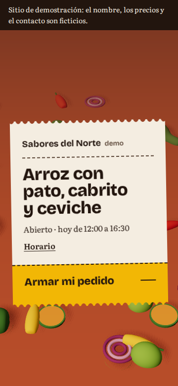   | 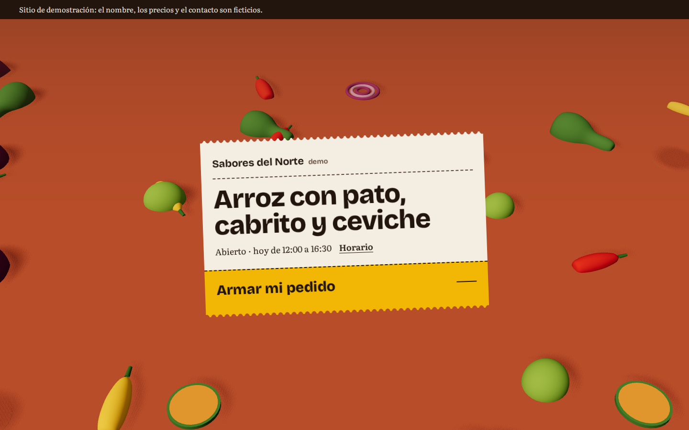   |
| 2 · Mitad del scroll | 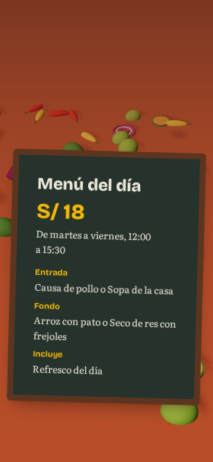    | 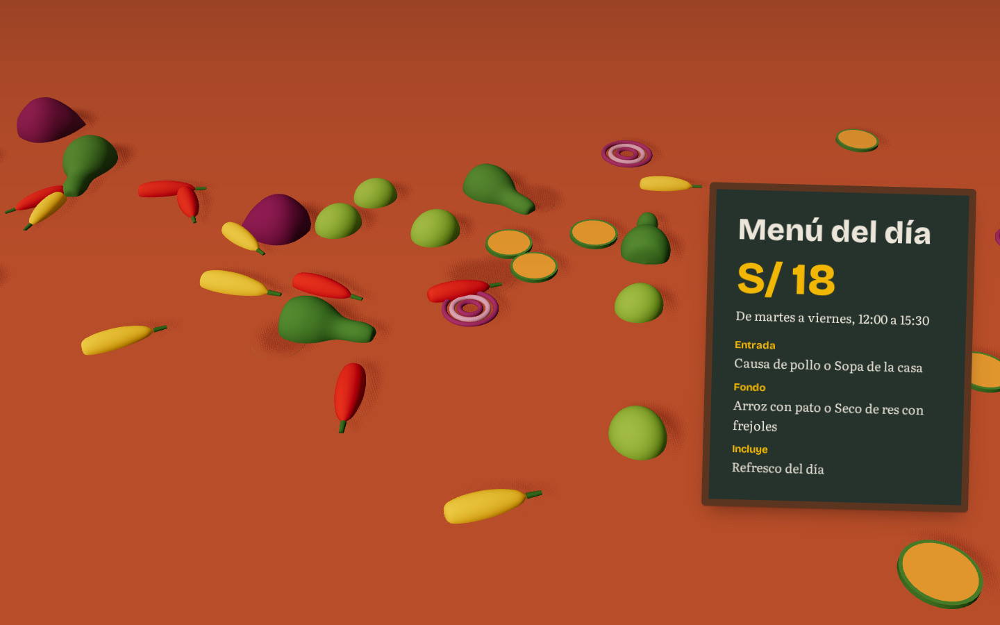    |
| 3 · Función estrella | 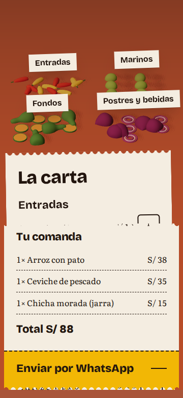 | 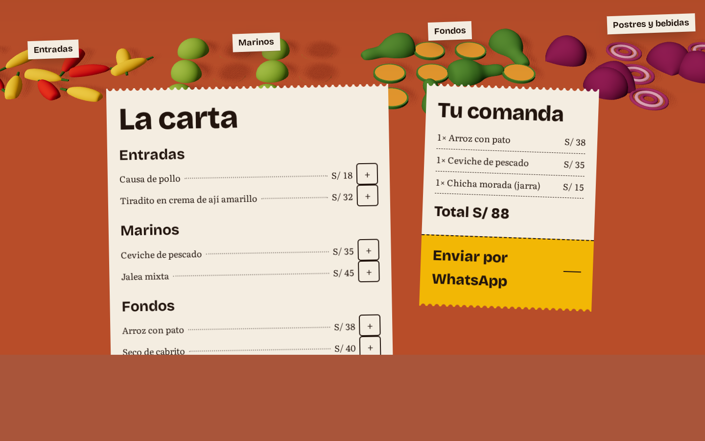 |

### B · «Pizarra de la cocina»

> De frente a la pared de la cocina: lo de hoy escrito con tiza y los ingredientes flotando delante, proyectando sombra sobre la pizarra.

- **Escena:** pizarra verde negra a pantalla completa con los ingredientes en el aire. Al bajar, caen a una repisa de madera ordenados por categoría, con el nombre escrito con tiza encima.
- **Paleta:** pizarra `#1e2923`, tiza `#ece6da` (12.6:1), ají `#f2b705` (8.7:1), madera `#7a4a2b`, papel `#f4ede1`.
- **Tipografía:** Archivo condensada (titulares, 72 %) + Newsreader (texto).
- **Componentes propios:**
  - la portada está escrita en la pizarra;
  - el único llamado es una comanda de papel sujeta con un imán;
  - el horario va en un recuadro de tiza;
  - la carta está escrita con tiza sobre la repisa;
  - tu comanda es otro papel con imán.
- **Titular:** «Cocina lambayecana, lista para pedir» (5 palabras).

| Cuadro               | 360 px                                                          | 1440 px                                                          |
| -------------------- | --------------------------------------------------------------- | ---------------------------------------------------------------- |
| 1 · Inicio           | 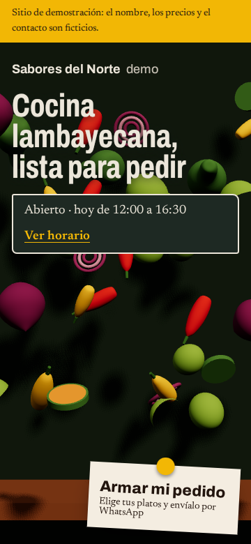   | 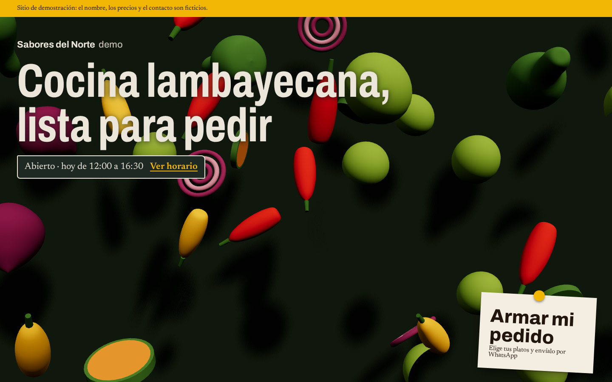   |
| 2 · Mitad del scroll | 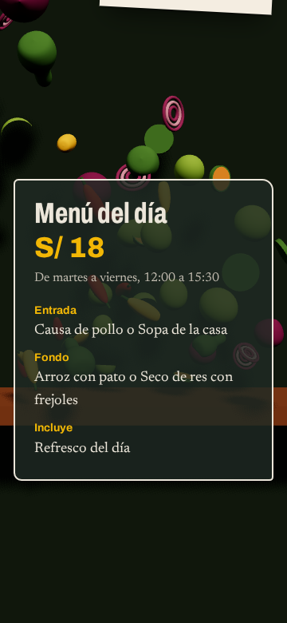    | 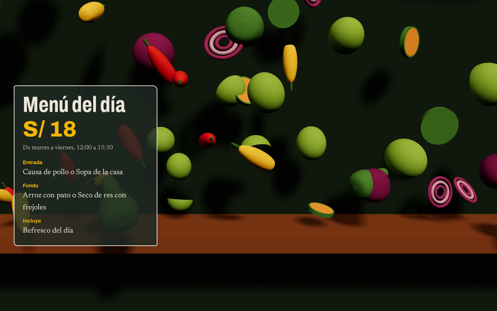    |
| 3 · Función estrella | 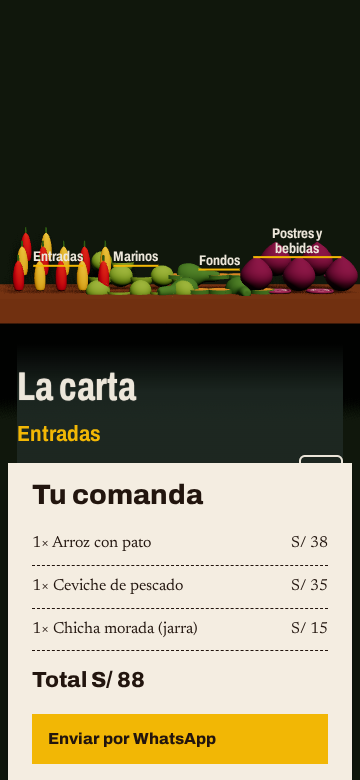 | 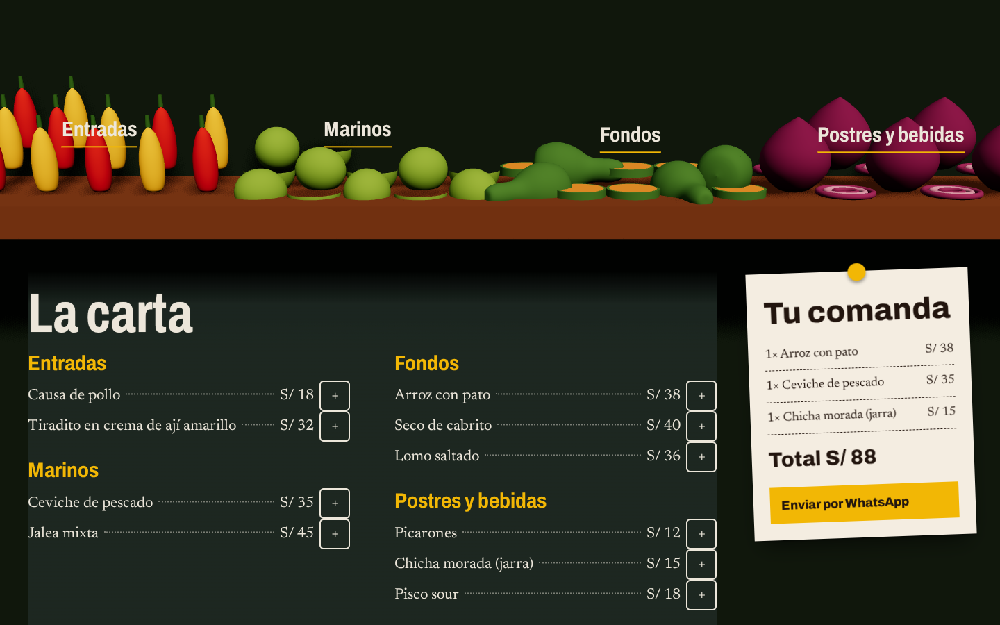 |

### C · «El pase»

> Frente al mostrador por donde sale la comida: todo lo que se lee cuelga del riel de comandas, y los ingredientes caen cada uno en su bowl.

- **Escena:** a la altura de los ojos, con pared de terracota, mostrador mate y 4 bowls de barro. Los ingredientes están en el aire, como recién lanzados, y al bajar caen en su bowl.
- **Paleta:** pared `#a3472b`, mostrador `#eee3d3`, papel `#fbf7ef`, tinta `#1f1712` (17:1 sobre papel), ají `#f2b705`, acero `#8d8a85`, pizarra `#26332c`.
- **Tipografía:** Fraunces con sus ejes «soft» y «wonk» (titulares) + Figtree (texto).
- **Componentes propios:**
  - un **riel de comandas** cruza la pantalla, y la portada y el llamado son comandas colgadas con pinza;
  - **la carta son 4 comandas, cada una colgada sobre el bowl de su categoría.** En celular se deslizan por el riel de una en una.
  - tu comanda sale impresa abajo;
  - el menú del día y el horario van en pizarra.
- **Titular:** «Arma tu comanda por WhatsApp» (5 palabras).

| Cuadro               | 360 px                                                          | 1440 px                                                          |
| -------------------- | --------------------------------------------------------------- | ---------------------------------------------------------------- |
| 1 · Inicio           | 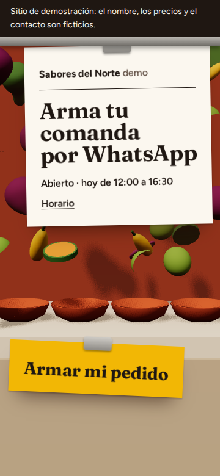   | 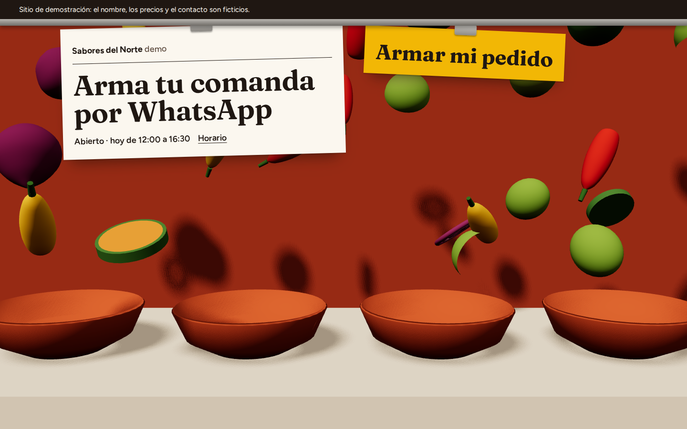   |
| 2 · Mitad del scroll | 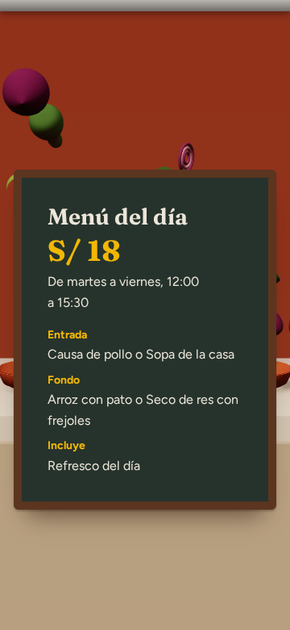    | 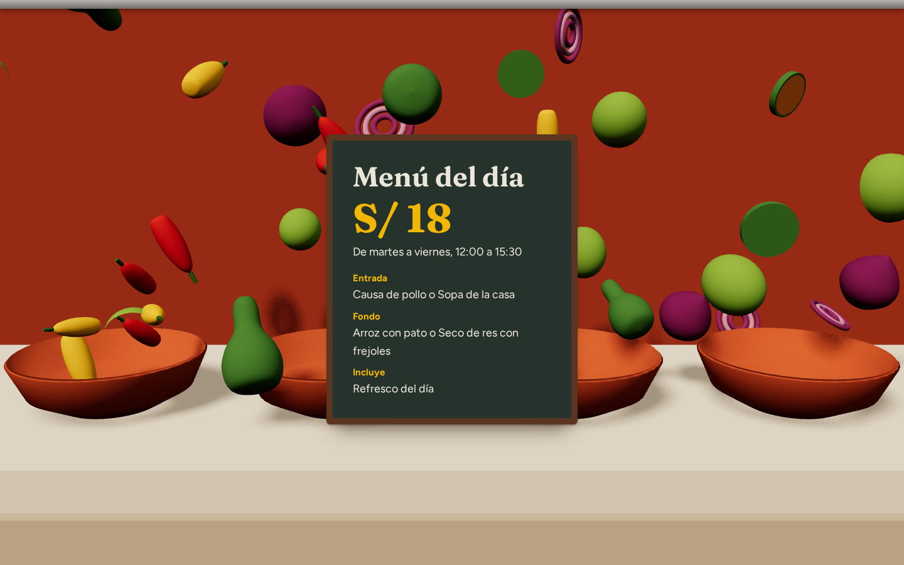    |
| 3 · Función estrella | 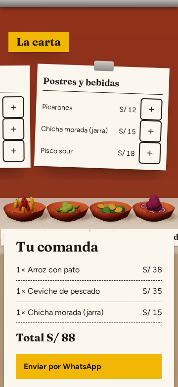 | 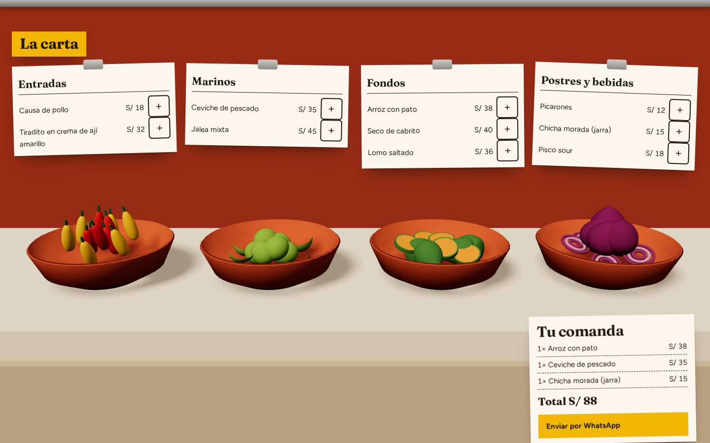 |

---

## Control de exigencias (antes de construir)

**Cómo se midió:** las exigencias 1, 2, 3 (cobertura) y 5 las mide `storyboard.mjs` sobre la página abierta, a 360×780 y 1440×900, y deja el resultado en [control.json](restaurante-cocina-abierta/storyboard/control.json). La 3 («coherente») y la 4 se juzgan con la captura indicada.

**Correcciones en bucle hasta que todo pasó:**

| Dirección | Problema detectado                                                              | Corrección                                                                     |
| --------- | ------------------------------------------------------------------------------- | ------------------------------------------------------------------------------ |
| A         | Titular en 3 líneas en escritorio                                               | Comanda más ancha                                                              |
| A         | Vista cenital: objetos sueltos sobre un fondo plano y texto a un lado           | Cámara inclinada, niebla, el doble de piezas y la comanda centrada entre ellas |
| A         | Franja más clara abajo: borde de la caja de sombras                             | Caja de sombras más grande                                                     |
| B         | «Ver horario» se perdía sobre la cebolla de atrás                               | Recuadro del horario con fondo de pizarra y sombra en el titular               |
| B         | El llamado quedaba bajo el pliegue a 360 px (el aviso ocupa 2 líneas)           | Altura de la portada corregida en celular                                      |
| B         | Al final se veían solo 2 de los 4 grupos                                        | Grupos más juntos y cámara sin acercamiento                                    |
| C         | Titular en 3 líneas en escritorio                                               | Comanda más ancha                                                              |
| C         | Al final la carta larga tapaba los bowls                                        | La carta pasó a ser 4 comandas, una sobre cada bowl                            |
| C         | En celular las 4 comandas en 2 columnas partían los nombres palabra por palabra | Riel deslizable con una comanda a la vez                                       |

**Resultado final** (✔ = pasa en 360 y 1440 px):

| Exigencia                                                                                                                                                                                         | A                                                    | B                                                  | C                                     | Captura de prueba                       |
| ------------------------------------------------------------------------------------------------------------------------------------------------------------------------------------------------- | ---------------------------------------------------- | -------------------------------------------------- | ------------------------------------- | --------------------------------------- |
| **1. La primera pantalla informa**: nombre, titular, «Abierto · hoy de 12:00 a 16:30», enlace al horario y botón, sin scroll                                                                      | ✔ medido                                             | ✔ medido                                           | ✔ medido                              | `?-1-inicio-360/1440.png`               |
| **2. Titulares cortos**: principal ≤ 6 palabras, ≤ 2 líneas en escritorio y ≤ 3 en celular; secciones ≤ 5 palabras                                                                                | ✔ 6 palabras · 2 / 3 líneas · secciones ≤ 3          | ✔ 5 · 2 / 3 · ≤ 3                                  | ✔ 5 · 2 / 3 · ≤ 3                     | `?-1-inicio-*.png`                      |
| **3. 3D inmersivo y coherente**: escena a pantalla completa, interfaz dentro de ella, mate y con colores de los tokens, cambia con el scroll y anuncia la carta                                   | ✔ escena 100 %, interfaz dentro; piezas mate         | ✔ 100 %, dentro                                    | ✔ 100 %, dentro                       | `?-1-inicio` y `?-2-mitad`              |
| **4. Nada de plantilla**: sin hero partido, sin un par de botones como único llamado, sin 3 tarjetas iguales, secciones con ritmo propio, fondo con profundidad; al menos 2 componentes del rubro | ✔ comanda centrada con talón; pizarra; carta-comanda | ✔ tiza a pantalla completa; papel con imán; repisa | ✔ riel con comandas; comanda por bowl | `?-1-inicio-1440` y `?-3-estrella-1440` |
| **5. Un solo lenguaje**: misma tipografía y materia en portada y secciones                                                                                                                        | ✔ Bricolage / Literata en todo                       | ✔ Archivo / Newsreader en todo                     | ✔ Fraunces / Figtree en todo          | `hoja-1440.png` y `hoja-360.png`        |

**La prueba de la exigencia 3:** «si el 3D se reemplaza por una foto recortada, ¿la página se entiende igual?»

- **En las 3, no.** Los grupos de ingredientes son las categorías de la carta y las etiquetas se anclan a ellos.
- **En C además:** cada comanda de la carta cuelga sobre su bowl.

**La prueba de la exigencia 4:** «con el nombre y las fotos tapados, ¿podría ser la plantilla de cualquier negocio?»

- **En las 3, no:** son una comanda en un mesón, tiza en una pizarra de cocina y un riel de comandas en el pase.

Hojas completas: [hoja-1440.png](restaurante-cocina-abierta/storyboard/hoja-1440.png) · [hoja-360.png](restaurante-cocina-abierta/storyboard/hoja-360.png).

---

## Elección (modo autónomo)

Puntaje de 1 a 5:

| Criterio                                                           | A · Mesón | B · Pizarra | C · El pase |
| ------------------------------------------------------------------ | --------- | ----------- | ----------- |
| Exigencias 1, 2 y 5 (medidas)                                      | 5         | 5           | 5           |
| Exigencia 3: inmersión y «los ingredientes forman la carta»        | 4         | 5           | 5           |
| Exigencia 4: componentes que solo tienen sentido en un restaurante | 4         | 4           | **5**       |
| Identidad distinta de los rubros que vienen                        | 5         | **2**       | 5           |
| Costo de rendimiento (sombras, piezas en pantalla)                 | 3         | 3           | 4           |
| Función estrella (la comanda) a la vista en el cuadro 3            | 4         | 4           | 5           |
| **Total**                                                          | 25        | 23          | **29**      |

**Elegida: C «El pase».**

- **El concepto se cumple de forma literal:** cada categoría es un bowl con su comanda colgada encima. La carta _es_ la cocina.
- **El riel de comandas es un componente que solo existe en un restaurante.** Hace de portada, de llamado, de carta y de pedido.
- **Deja libres los fondos oscuros para la barbería («Filo», negro y dorado).** B es la más llamativa en la portada, pero su pizarra a pantalla completa queda demasiado cerca de lo que viene.
- **Es la de menor costo:** la escena es más chica (pared, mostrador y bowls), con menos superficie con sombras que el mesón de A.

**Lo que se toma de las otras:**

- **De B:** el horario en un recuadro de tiza con fondo sólido, para que siempre se lea sobre el 3D.
- **De A:** las sombras largas y la niebla cálida para dar profundidad.
