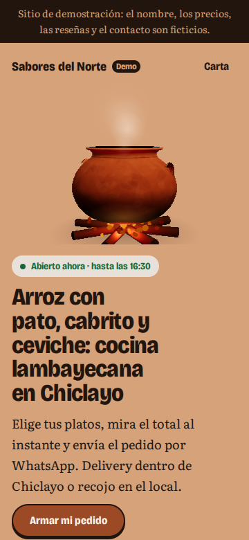
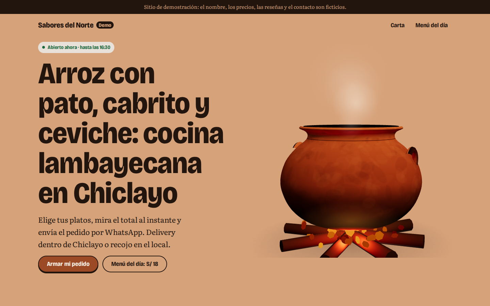
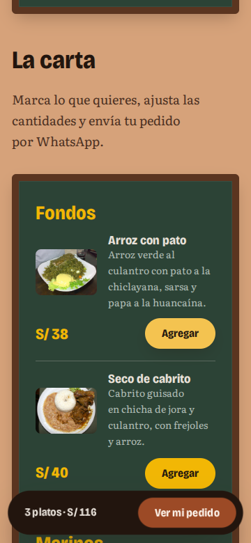
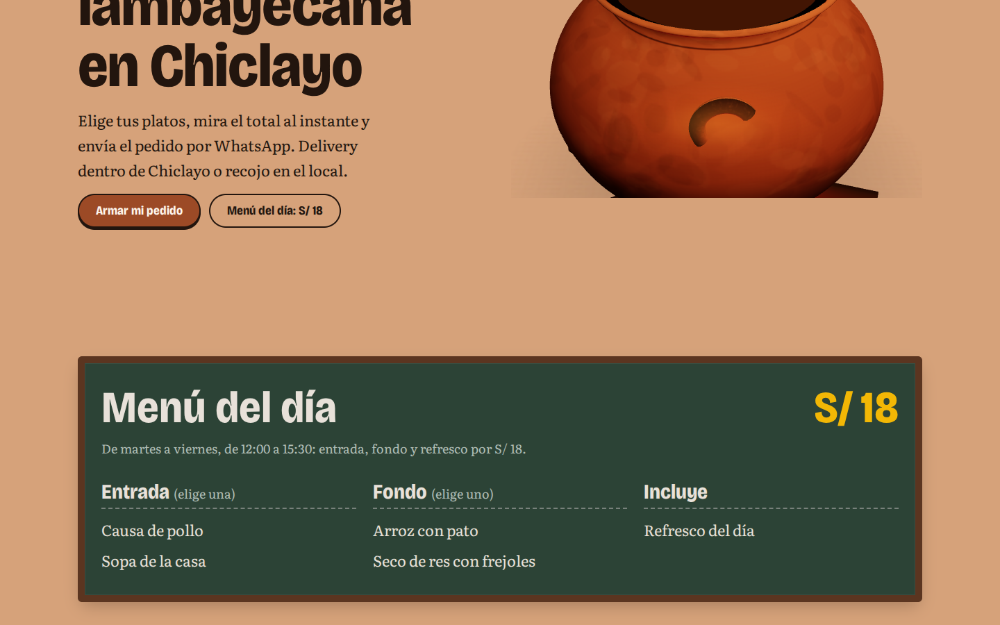
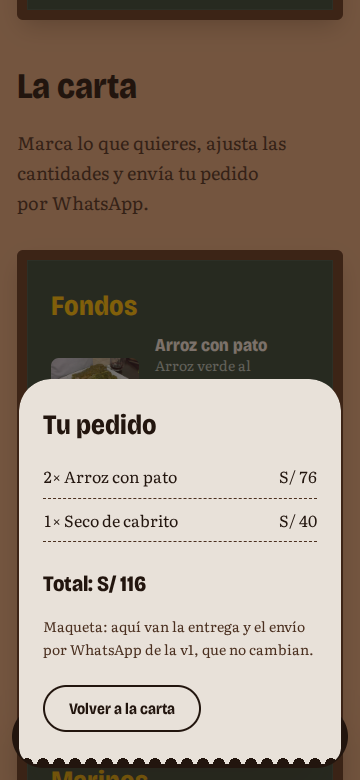
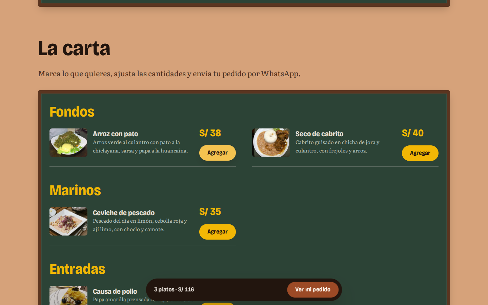

# Brief visual · Restaurante v2 inmersivo («Sabores del Norte · Demo»)

- **Estado:** **no aprobada** por Iván el 2026-10-26.
  - **Motivos:** la olla realista se veía anticuada frente a la interfaz minimalista y quedaba suelta al costado del texto; el titular era largo; no se veía el horario; la composición se sentía de plantilla.
  - **Lo que salió de aquí:** las _Exigencias de diseño_ del plan (ADR 009).
  - **Lo que sigue:** la segunda ronda está en [restaurante-cocina-abierta.md](restaurante-cocina-abierta.md).
  - **Lo que se conserva:** la imagen fija liviana, el ADR 008 y las herramientas de la maqueta.
- **Fecha:** 2026-10-26
- **Identidad de partida:** «Fuego y barro», la cocina de leña de una picantería ([identidad.md](identidad.md)).
- **Alcance:** solo cambia la capa de presentación de la v1 ([restaurante.md](restaurante.md)).
  - No cambian: carrito, comanda, reservas, `negocio.json` ni las pruebas.
  - `test:teclado` y `a11y` deben seguir pasando.
- **Presupuesto:** [ADR 008](../decisiones/008-presupuesto-con-3d.md).
  - Punto de partida: LCP móvil 2.41 s y rendimiento 98, con las fuentes ya recortadas.

---

## Paso 1 · Referencias

**Skills usadas:**

- **`anti-ui-slop`:** se cargó con su guía para trabajo nuevo, pero su servicio de pantallas reales (UIZZE) **no está conectado** en esta sesión, así que no aportó referencias. Como prevé el plan, las referencias salieron de búsqueda web y de capturas propias.
- **`crear-web-como-servicio`:** de su guía de nicho, la recomendación para restaurantes (reserva y carta, más un asistente como mejora vendible). De sus archivos de arquetipos y de reglas de diversidad, qué no repetir del ejemplo de restaurante que trae la skill: el carrusel horizontal fijo de 8 a 12 platos, el degradado de malla rojo y los caracteres decorativos.

Las capturas de webs de terceros se guardaron fuera del repo y no se suben.

### Las 3 mejores webs reales del rubro

| Web                                                  | Qué hace bien                                                                                                                                                                                                            | Qué tomamos                                                                                                                 | Qué no copiamos                                                                                                                      |
| ---------------------------------------------------- | ------------------------------------------------------------------------------------------------------------------------------------------------------------------------------------------------------------------------ | --------------------------------------------------------------------------------------------------------------------------- | ------------------------------------------------------------------------------------------------------------------------------------ |
| [Ekstedt](https://www.ekstedt.nu/) (Estocolmo)       | Un restaurante que cocina solo con leña. Su primera pantalla es un video de humo y fuego, y la frase explica el método: «Birchwood and smoke are our most powerful tools». «Reservation» aparece 3 veces antes de bajar. | El fuego **explica** la cocina, no la adorna. Aquí: la leña de algarrobo y la olla de barro son el método de la picantería. | Video de 2 a 4 MB en la primera pantalla: en 4G rompe el LCP. Nosotros usamos el póster del ADR 008.                                 |
| [Central](https://centralrestaurante.com.pe/) (Lima) | La página es «un recorrido vertical por el territorio peruano»: el scroll baja por alturas, del mar a la Amazonía. Dos fotos macro de ingredientes, de borde a borde, sin texto encima.                                  | **El scroll como recorrido con sentido.** Aquí: del humo del fogón a la olla, y de la olla a tu mesa (la comanda).          | No hay precios ni carta en la portada. A 360 px la primera pantalla es solo fotos y el botón de reservar queda escondido en el menú. |
| [Isolina](https://isolina.pe/) (Lima)                | Taberna criolla con foto cenital de comida a pantalla completa y las 5 acciones (Reservas, Para recoger, Delivery…) visibles desde la primera pantalla. Es la que más se parece a lo que vende un negocio de Chiclayo.   | **Acciones visibles de entrada**, que la v1 ya cumple con «Armar mi pedido» y el menú del día con su precio.                | La carta vive en otra página.                                                                                                        |

**Lo que el rubro espera** sigue igual que en la v1: carta con precios en la página, horario y dirección a la vista, y un solo botón claro para pedir. **La oportunidad es la misma, con una diferencia:** ninguna de las tres convierte la cocina en algo que se pueda tocar. Ekstedt la filma y Central la fotografía. Aquí la olla de barro se mueve con tu dedo y el plato cae en tu pedido.

### 5 referencias de inmersión (premiadas por movimiento o 3D)

Son de cualquier rubro. Los premios se verificaron en la página de Awwwards de cada sitio o en fuentes que la citan.

| Referencia                                           | Premio                                                      | Técnica que tomamos                                                                                                                                                                 | Cómo la adaptamos                                                                                                                                                                                                                                      |
| ---------------------------------------------------- | ----------------------------------------------------------- | ----------------------------------------------------------------------------------------------------------------------------------------------------------------------------------- | ------------------------------------------------------------------------------------------------------------------------------------------------------------------------------------------------------------------------------------------------------ |
| [Oryzo](https://oryzo.ai/), de Lusion                | Awwwards Site of the Month, abril de 2026                   | **Un solo objeto 3D con textura de material real**, un posavasos de corcho que gira y se acerca con el scroll. Con el título a un lado y el texto al otro, el objeto es la portada. | La olla o el plato de barro, con la porosidad del barro cocido y el hollín en la base. En nuestra captura (Chromium sin GPU, no representa un celular) seguía en su pantalla de carga a los 8 s. Nosotros mostramos el póster desde el primer pintado. |
| [Igloo Inc](https://www.igloo.inc/)                  | Awwwards Site of the Year 2024 (Developer Award)            | **Partículas y niebla que se arman y se disuelven con el scroll**, con refracción tipo prisma sobre bloques de hielo.                                                               | El vapor de la olla como partículas que suben, más densas al llegar al menú del día y que se disipan al bajar. Sin pantalla de carga.                                                                                                                  |
| [Explore Primland](https://explore.ownprimland.com/) | Awwwards Site of the Day, febrero de 2026                   | **Cámara que se desliza con el scroll sobre un terreno real**, entre bancos de niebla.                                                                                              | El humo del fogón como capas de niebla que la cámara atraviesa del hero a la carta. Solo en la dirección B (escena persistente).                                                                                                                       |
| [Hubtown](https://hubtown.co.in/), de Unseen Studio  | Awwwards Site of the Day, junio de 2026                     | **Objeto que brilla desde dentro, y el cursor revela detalle en su luz**. El titular se arma letra por letra.                                                                       | La brasa bajo la olla, que se aviva donde pasa el cursor o el dedo. El titular que «se arma» es una de las 3 coreografías de scroll.                                                                                                                   |
| [SŌM](https://www.drinksom.eu/), de .RAW             | Awwwards Site of the Day, 4 de abril de 2026 (food & drink) | **Interacción 3D con el mouse en una marca de bebida**, que no estorba la compra: el carrito está siempre visible.                                                                  | La regla de oro para nosotros: el 3D nunca tapa «Armar mi pedido» ni la barra del pedido. Lo que no tomamos: su ventana de país, que tapa la primera pantalla.                                                                                         |

**Conclusión del paso 1:** los sitios premiados ganan con **un objeto memorable y un recorrido con sentido**, pero Oryzo e Igloo abren con una pantalla de carga (en nuestra captura sin GPU seguían ahí a los 8 s). Nuestra ventaja posible: la misma sensación con contenido desde el primer pintado (ADR 008).

---

## Paso 2 · Tres direcciones

**Skills usadas:**

- **`frontend-design`:** la advertencia que más pesó aquí es que «fondo crema + acento terracota + serif de titular» es hoy la combinación que más delata una página hecha por IA, y es justo el color de partida de la matriz («terracota, carbón, crema»). Por eso ninguna dirección usa crema de fondo: la de partida se convierte en **adobe, hollín o cal**, colores que sí están en una picantería.
- **`crear-web-como-servicio`:** los arquetipos y sus reglas de diversidad. Dos arquetipos ya están tomados: barbería **02 Dark Warm** y dental **01 Light Cream**. La v1 usó **09 Newspaper**.

**Lo que no cambia en ninguna de las tres:**

- El contenido sigue en el HTML.
- El LCP es el póster de la escena (ADR 008).
- El 3D se hace con Three.js, sin modelo descargado: la olla y el plato se modelan en código, con un torno (`LatheGeometry`).
- Las coreografías de scroll se hacen con GSAP ScrollTrigger y las View Transitions al abrir y cerrar la comanda.
- La función estrella cumple la matriz: **el plato cae a la comanda y el ticket se imprime**.

Contraste medido sobre los hex propuestos (texto normal ≥ 4.5:1). El paso 3 lo vuelve a verificar con los tokens definitivos.

### A · «La olla manda»

> La olla de barro es la portada: gira con tu scroll, suelta vapor y todo lo demás (carta, pedido, reserva) pasa a su alrededor.

- **Arquetipo:** 10 Spline Embed Premium, adaptado. Un solo objeto 3D en el hero, hecho con Three.js en vez de Spline (ADR 008), y el resto de la página sobrio. Su paleta neón de manual se reemplaza por la de barro.
- **Momento firma:** la olla de barro de Mórrope (Lambayeque), con su textura de barro paleteado, sobre brasas de algarrobo.
  - Gira media vuelta con el scroll del hero.
  - Las partículas de vapor suben más rápido sobre el menú del día.
  - El cursor o el dedo avivan la brasa bajo la olla (técnica de Hubtown).
- **Paleta:**

  | Rol                    | Color        | Hex       | Contraste                   |
  | ---------------------- | ------------ | --------- | --------------------------- |
  | Fondo                  | adobe        | `#d6a27a` | hollín sobre adobe: 7.88:1  |
  | Texto                  | hollín       | `#22150e` |                             |
  | Botón principal        | barro cocido | `#9c4a26` | con texto `#fff7ee`: 5.78:1 |
  | Resaltador             | ají amarillo | `#f2b705` | con texto hollín: 9.78:1    |
  | Superficie de la carta | ceniza clara | `#e8e1d9` | texto hollín: 13.71:1       |

  Un fondo de color medio (adobe) es poco común y es lo primero que se recuerda.

- **Par tipográfico:**
  - **Bricolage Grotesque** variable en titulares: grotesca de trazo irregular, como letra pintada a mano en un letrero; usa sus ejes de ancho y tamaño óptico.
  - **Literata** en el texto: serif de lectura, cálida y abierta.

- **Lenguaje de movimiento:** pesado y generoso, como una olla llena.
  - Las entradas pesan: curva ease-out larga, sin rebote, de 400 a 600 ms en lo decorativo y de 150 a 250 ms en botones.
  - El plato agregado cae en arco a la barra del pedido.
  - El ticket se imprime línea por línea, como en la v1.
- **Las 3 coreografías de scroll:**
  1. La olla gira y la cámara se acerca hasta el borde.
  2. El titular se arma palabra por palabra.
  3. Las categorías de la carta suben en capas, como el vapor.
- **Costo estimado:** bajo. Es una sola escena en el hero que se pausa al salir de pantalla, el caso ideal del ADR 008.
- **Riesgo:** parecerse a Oryzo (objeto redondo café que gira). Se evita con la composición: la olla va de lado, abierta y humeante, con la carta debajo, y no centrada como un producto en un estudio.

```text
360 px                         1440 px
┌──────────────────┐           ┌───────────────────────────────────────────┐
│ Sabores del Norte│           │ Sabores del Norte        Carta  Reservar  │
│   ~ ~ vapor ~ ~  │           │                     ~ ~ vapor ~ ~         │
│   ╭──────────╮   │           │  Arroz con pato,     ╭──────────────╮     │
│   │  OLLA 3D │   │           │  cabrito y ceviche   │   OLLA 3D    │     │
│   ╰──────────╯   │           │  …                   │  (póster =   │     │
│   ▒▒ brasas ▒▒   │           │  [Armar mi pedido]   │   LCP)       │     │
│ Arroz con pato,  │           │  Menú del día S/ 18  ╰──────────────╯     │
│ cabrito y …      │           │                      ▒▒▒ brasas ▒▒▒       │
│ [Armar mi pedido]│           ├───────────────────────────────────────────┤
│ Menú del día S/18│           │ carta sobre ceniza clara …                │
└──────────────────┘           └───────────────────────────────────────────┘
```

### B · «Fogón de noche»

> Entras a la cocina de la picantería al anochecer: el scroll te lleva a través del humo hasta el fuego, y del fuego a la mesa.

- **Arquetipo:** 03 Cinematic 3D Storytelling. Una escena 3D persistente detrás de toda la página, con la cámara guiada por el scroll.
- **Momento firma:** el fogón completo, con leña de algarrobo, brasas, la olla encima y humo en capas.
  - La cámara baja del humo a las llamas en el hero (técnica de Primland).
  - Se acerca a la olla en el menú del día.
  - Termina sobre la mesa en la reserva.
  - Las chispas siguen al cursor.
- **Paleta:**

  | Rol              | Color      | Hex       | Contraste                |
  | ---------------- | ---------- | --------- | ------------------------ |
  | Fondo            | hollín     | `#17100c` |                          |
  | Texto            | humo claro | `#f1e6da` | 15.30:1                  |
  | Texto secundario | ceniza     | `#b8ada3` | 8.55:1                   |
  | Botón            | brasa      | `#ff6a1f` | con texto hollín: 6.57:1 |
  | Destello         | llama      | `#ffb347` | solo para resaltar       |
  | Superficie       | barro      | `#8a3d22` | tarjetas de la carta     |

- **Par tipográfico:**
  - **Fraunces** variable en titulares, con sus ejes «soft» y «wonk»: serif blanda, como letra que se derrite con el calor.
  - **Figtree** en el texto: sans clara para leer sobre fondo oscuro.
- **Lenguaje de movimiento:** respira como el fuego.
  - Parpadeo lento de la luz, de 2 a 4 s.
  - Los cambios de sección se funden a través del humo.
  - El plato agregado sube como una chispa hasta el pedido.
  - El ticket se imprime iluminado por la brasa.
- **Las 3 coreografías de scroll:**
  1. La cámara recorre el humo, el fuego, la olla y la mesa.
  2. La niebla se abre para dejar ver cada sección.
  3. El titular se enciende letra por letra, como brasa.
- **Costo estimado:** **alto**.
  - La escena nunca sale de pantalla, así que la pausa del ADR 008 no aplica: solo se puede bajar su ritmo.
  - Un póster oscuro comprime bien, pero el TBT y la batería sufren en gama media.
  - Es la dirección con más riesgo de bajar de 90.
- **Riesgos:**
  - Fondo casi negro con un solo acento es uno de los rasgos «por defecto» que señala `frontend-design`.
  - Además queda cerca de la barbería (02, negro y dorado).
  - Para distinguirlos: aquí el fondo es café hollín, el acento es naranja vivo y nada es cromado. El ritmo también es opuesto: lento y orgánico frente a cortes secos.

```text
360 px                         1440 px
┌──────────────────┐           ┌───────────────────────────────────────────┐
│░░░ humo ░░░░░░░░░│           │░░░░░░░░░░ humo ░░░░░░░░░░░░░░░░░░░░░░░░░░░│
│ Sabores del Norte│           │ Sabores del Norte             [Reservar]  │
│░░░░░░░░░░░░░░░░░░│           │░░░░  Arroz con pato,  ░░░░░░░░░░░░░░░░░░░░│
│  ^ ^ llamas ^ ^  │           │░░░░  cabrito y ceviche    ^ ^ ^ llamas    │
│  ╱╲ leña ╱╲ ╱╲   │           │      [Armar mi pedido]   ╱╲ ╱╲ leña ╱╲    │
│ Arroz con pato…  │           │   (escena fija detrás de toda la página)  │
│ [Armar mi pedido]│           │                                           │
└──────────────────┘           └───────────────────────────────────────────┘
```

### C · «Pizarra y torno»

> La picantería de barrio a la luz del mediodía: paredes de cal, la pizarra con el menú del día pintada a mano y un plato de barro que gira como en el torno del alfarero.

- **Arquetipo:** 07 Brutalist, en versión cálida.
  - Grilla estricta y tipografía enorme, como los letreros pintados de las picanterías.
  - Ninguno de los arquetipos tomados (02, 01, 09) se le parece.
- **Momento firma:** un plato de barro de Mórrope con un ceviche o un arroz con pato modelado en volúmenes simples.
  - Gira con el scroll como en el torno del alfarero.
  - Suelta vapor.
  - Al agregar un plato a la carta, una copia pequeña del plato 3D «cae» en la barra del pedido.
- **Paleta:**

  | Rol                   | Color        | Hex       | Contraste                               |
  | --------------------- | ------------ | --------- | --------------------------------------- |
  | Fondo                 | cal          | `#e6e9e4` | blanco frío de pared encalada, no crema |
  | Texto                 | hollín       | `#201a17` | 14.03:1                                 |
  | Bloques de la pizarra | verde pared  | `#46705a` | con texto blanco: 5.64:1                |
  | Botón                 | barro        | `#9a3f22` | con texto de cal: 5.51:1                |
  | Resaltador            | ají amarillo | `#f2b705` | con texto hollín: 9.46:1                |

- **Par tipográfico:**
  - **Bungee** en titulares y precios: letra de rótulo, hecha para letreros y que se lee de lejos.
  - **Archivo** en el texto: ya está recortada y precargada, así que el costo de fuentes no sube.
- **Lenguaje de movimiento:** el gesto del pintor y del alfarero.
  - Los titulares se pintan de izquierda a derecha, con un barrido de recorte (`clip-path`) de 300 a 400 ms.
  - El plato gira con el scroll y se detiene con inercia.
  - El plato agregado cae a la barra con un rebote corto.
  - El ticket se imprime.
- **Las 3 coreografías de scroll:**
  1. El torno: el plato gira y se inclina para mostrar el contenido.
  2. Los titulares de cada sección se pintan al entrar.
  3. Los bloques de la pizarra (menú del día, horario) se deslizan a su lugar de la grilla.
- **Costo estimado:** bajo, similar al de A. Tiene una sola escena en el hero y reutiliza Archivo. Bungee es una fuente estática liviana.
- **Riesgos:**
  - El estilo brutalista puede sentirse frío. Se compensa con el barro, el vapor y el amarillo ají.
  - Bungee en mayúsculas cansa en párrafos: va solo en titulares y precios.

```text
360 px                         1440 px
┌──────────────────┐           ┌───────────┬───────────────┬───────────────┐
│ SABORES DEL NORTE│           │ SABORES   │               │ MENÚ DEL DÍA  │
├──────────────────┤           │ DEL NORTE │   ╭───────╮   │ ▓▓ S/ 18 ▓▓▓▓ │
│    ╭────────╮    │           │           │   │PLATO  │   │ ▓ Causa ▓▓▓▓▓ │
│    │PLATO 3D│    │           │ ARROZ CON │   │ 3D    │   │ ▓ Arroz c/pato│
│    ╰────────╯    │           │ PATO,     │   ╰───────╯   │ (pizarra      │
│ ARROZ CON PATO,  │           │ CABRITO…  │   ~ vapor ~   │  verde)       │
│ CABRITO Y …      │           │[Armar mi pedido]          │               │
│[Armar mi pedido] │           ├───────────┴───────────────┴───────────────┤
│▓ MENÚ DEL DÍA 18▓│           │ carta en grilla estricta …                │
└──────────────────┘           └───────────────────────────────────────────┘
```

### Comparación y recomendación

|                        | A · La olla manda         | B · Fogón de noche            | C · Pizarra y torno                      |
| ---------------------- | ------------------------- | ----------------------------- | ---------------------------------------- |
| Sensación              | cálida, artesanal, de día | cinematográfica, nocturna     | popular, gráfica, de mediodía            |
| Riesgo de presupuesto  | bajo                      | **alto** (escena persistente) | bajo                                     |
| Distancia con barbería | grande                    | **poca** (las dos oscuras)    | grande                                   |
| Distancia con dental   | grande (adobe, no crema)  | grande                        | media (fondo claro, pero frío y gráfico) |
| Costo de fuentes       | 2 fuentes nuevas          | 2 fuentes nuevas              | 1 nueva (Archivo se queda)               |
| Se recuerda por        | la olla humeante          | el viaje por el fuego         | el plato en el torno y la pizarra        |

**Recomendación: A.**

- Es la que mejor cumple la matriz: el momento firma es literalmente la olla de barro con vapor.
- Su costo encaja en el ADR 008 con margen.
- El fondo adobe es su propio sello, sin chocar con la barbería ni con la clínica.

**C es la alternativa** si quieres más personalidad gráfica y menos «producto». **B es la más vistosa en video,** pero es la que más probablemente te obligue a la decisión del ADR 008 (aceptar 85 o aligerar).

### Elección de Iván (2026-10-26)

**A «La olla manda», con un cambio:** la carta y el menú del día usan **la pizarra verde de C**, adaptada a la paleta y la tipografía de A.

- **Sí:** el verde de pizarra como superficie de la carta y del menú del día, con la grilla que acomoda los bloques de C.
- **No:** Bungee. Toda la página usa Bricolage Grotesque y Literata.
- **El resto es A:** fondo adobe, la olla 3D en el hero, el ritmo pesado y generoso, y las 3 coreografías de A.

---

## Paso 3 · Sistema visual

**Skills usadas:**

- **`ui-ux-pro-max`:** su sistema de diseño genérico para «restaurante» proponía rojo rosado con Playfair Display. Contradice la dirección que ya elegiste, así que no se adoptó. Sí se tomaron sus reglas de ritmo: escalonado de 300 a 450 ms y rebote (`back.out`) solo fuera del contenido denso. También su regla de Three.js de liberar las texturas.
- **`design:design-system`:** se usan los nombres del núcleo (`--color-marca`, `--color-fondo`…) y solo se agregan los que faltan (pizarra, tiza, marco, curvas de movimiento). Los colores no quedan como valores sueltos en los componentes.

Los tokens están en [restaurante-inmersivo/tokens.css](restaurante-inmersivo/tokens.css).

### Paleta y contraste (medido)

| Token                              | Hex                    | Uso                  | Contraste                                  |
| ---------------------------------- | ---------------------- | -------------------- | ------------------------------------------ |
| `--color-fondo`                    | `#d6a27a`              | adobe                | —                                          |
| `--color-texto`                    | `#22150e`              | hollín               | 7.88:1 sobre adobe                         |
| `--color-texto-suave`              | `#4a2f1f`              | bajadas, notas       | 5.42:1 sobre adobe                         |
| `--color-marca`                    | `#9c4a26`              | botón principal      | texto `#fff7ee` 5.78:1                     |
| `--color-acento`                   | `#f2b705`              | precios, «Agregar»   | hollín encima 9.78:1; sobre pizarra 5.88:1 |
| `--color-superficie`               | `#e8e1d9`              | fichas, comanda      | hollín 13.71:1                             |
| `--color-pizarra` / `--color-tiza` | `#2c4336` / `#e8e1d9`  | carta y menú del día | 8.25:1                                     |
| `--color-foco`                     | hollín; ají en pizarra | anillo de foco       | 7.88:1 / 5.88:1                            |

**Hallazgos del paso 3:**

1. **El verde y el rojo de estado del núcleo dan ~3:1 sobre adobe**, menos que 4.5:1. «Abierto ahora» va siempre sobre una ficha de ceniza (5.3:1).
2. **El barro sobre adobe da 2.72:1.** Un botón de barro no se distingue del fondo por sí solo (WCAG 1.4.11), así que lleva borde y sombra de hollín.
3. **El anillo de foco no puede ser barro.** Es hollín y, sobre la pizarra, ají.

### Tipografía

- **Titulares:** Bricolage Grotesque, peso 600–800, con ancho y tamaño óptico fijos en el archivo recortado.
- **Texto:** Literata, peso 400–700.
- **Peso:** con `npm run fuentes`, 26 + 26 KB = 52 KB, menos que los 67 KB de la v1.
- **Escala fluida:** razón ~1.25 en celular y ~1.333 en escritorio. El titular va de 34 px a 360 a 88 px a 1280.
- **Interlineado:** 1 en titulares y 1.65 en texto.

### Grilla, formas y sombras

- **Grilla:** 4 columnas en celular y 12 desde 60rem. Hueco fluido de 16 a 32 px. Contenido de 76rem.
- **Radios:**
  - barro con curvas generosas: 8 / 16 / 32 px, y botones en píldora;
  - la pizarra lleva radio de 6 px y un marco recto de madera de algarrobo (10 px, `#5b3520`).
- **Sombras teñidas de hollín, nunca gris neutro.** La pizarra combina una línea interior clara con una sombra media.

---

## Paso 4 · Guion de movimiento

**Skills usadas:**

- **Diseñan:** `web-animation-design` y el catálogo de efectos de `crear-web-como-servicio`.
  - Reglas aplicadas: ease-out para lo que entra, ease-in-out para lo que ya está en pantalla, interfaz bajo 300 ms y sin animación en acciones de teclado.
  - Con movimiento reducido no se anima nada, incluida la opacidad.
- **Pulen después:** `emil-design-engineering` y `make-interfaces-feel-better`, al construir el rubro (como pide el plan).

| #   | Elemento                                                     | Disparador                                                 | Duración                               | Curva                                    | Movimiento reducido                    |
| --- | ------------------------------------------------------------ | ---------------------------------------------------------- | -------------------------------------- | ---------------------------------------- | -------------------------------------- |
| 1   | **Olla gira y la cámara se asoma** (coreografía 1)           | scroll del primer 60 % de pantalla (ScrollTrigger `scrub`) | ligada al scroll, inercia de ~200 ms   | lerp en la escena                        | sin 3D: queda el póster                |
| 2   | **Títulos que se arman** palabra por palabra (coreografía 2) | el título entra al 85 % de la pantalla, una vez            | 500 ms + 70 ms entre palabras          | `power4.out` (ease-out-quint)            | sin animación: el título ya está       |
| 3   | **Capas de la pizarra suben** (coreografía 3)                | la pizarra entra al 80 %, una vez                          | 500 ms + 120 ms entre capas            | `power4.out`                             | sin animación                          |
| 4   | Vapor (5 bocanadas, CSS)                                     | continuo; se pausa fuera de pantalla                       | 4.4 s cada una, desfasadas             | ease-out-quad                            | 2 bocanadas quietas                    |
| 5   | Brillo de la brasa (CSS)                                     | continuo; se aviva con el cursor o el dedo                 | late irregular de 2.3 s; respira 1.7 s | `steps` / ease-in-out                    | brillo fijo                            |
| 6   | **El plato cae a la barra**                                  | clic o toque en «Agregar» (con teclado no)                 | 520 ms                                 | X ease-out-quad; Y sube y cae acelerando | sin vuelo: el total cambia en la barra |
| 7   | Latido de la barra                                           | llega un plato                                             | 250 ms                                 | ease-out-quart                           | ninguno                                |
| 8   | **La barra se convierte en la comanda** (View Transition)    | «Ver mi pedido» / Escape / «Volver»                        | 300 ms                                 | ease-out-quart                           | se abre sin transición                 |
| 9   | El ticket se imprime                                         | se abre la comanda                                         | 250 ms por línea, 60 ms entre líneas   | ease-out-quart                           | sin animación                          |
| 10  | Póster → escena 3D                                           | la escena dibujó su primer cuadro                          | 500 ms                                 | fundido de `opacity`                     | no ocurre                              |
| 11  | Botón presionado                                             | `:active`                                                  | 150 ms                                 | ease-out-quart                           | ninguno                                |

**Plan de carga del 3D (ADR 008):**

1. El HTML trae la imagen fija de la olla (WebP con `srcset`, `fetchpriority="high"`). Es el LCP.
2. Con `load` y un momento libre (`requestIdleCallback`) llegan `coreografias.js` (GSAP) y `escena.js` (Three.js), cada uno con `import()`.
3. Antes de pedir Three.js se revisa si hay movimiento reducido, ahorro de datos, `deviceMemory` menor a 4 o falta WebGL2. En cualquiera de esos casos no se descarga.
4. Los shaders se compilan con `compileAsync`. El canvas aparece con un fundido cuando dibujó su primer cuadro.
5. La escena se redibuja solo cuando el scroll o el cursor la cambian. El vapor y la brasa son CSS, que mueve el compositor.
6. El bucle se pausa con `IntersectionObserver` y con la pestaña oculta.

---

## Paso 5 · Hero vivo

Archivos: [restaurante-inmersivo/](restaurante-inmersivo/).

- **`index.html`:** el contenido real de `negocio.json` (titular, menú del día y 4 platos con sus fotos y precios).
- **`escena.js`:** la olla torneada en código (`LatheGeometry`, sin modelo descargado), con textura de barro paleteado generada en un canvas, más leña y brasas.
- **`coreografias.js`:** las 3 coreografías.
- **`maqueta.js`:** el pedido mínimo, el vuelo del plato, la View Transition y la carga diferida.
- **`generar-poster.mjs`:** genera la imagen fija desde la misma escena y **falla si pesa más que la foto actual**.
- **`grabar.mjs`:** graba el recorrido, comprueba que «Armar mi pedido» quede en la primera pantalla y pasa Axe.

**Verla en tu navegador** (desde la carpeta del repo, en WSL):

```bash
npm run maqueta:build && npm run maqueta:preview
```

Abre **http://localhost:5181/** en Chrome o Edge de Windows. Con `npm run maqueta` (servidor de desarrollo) es **http://localhost:5180/**.

- **Para ver cada parte:** baja despacio por la portada para ver girar la olla, pasa el cursor sobre las brasas y agrega 2 o 3 platos.
- **`?3d=0`:** fuerza la imagen fija.
- **Movimiento reducido:** con «Efectos de animación» desactivado en Windows se ve la versión quieta.

**Video del recorrido** (Playwright, 25 a 33 s). Muestra la portada, el giro de la olla, el menú del día, la carta, 3 platos cayendo a la barra y la comanda:

- [recorrido a 360 px](restaurante-inmersivo/video/recorrido-360.mp4)
- [recorrido a 1440 px](restaurante-inmersivo/video/recorrido-1440.mp4)

> El video se grabó en Chromium **sin GPU**: el 3D se dibuja por software, así que se ve con menos cuadros por segundo y con cortes a mitad del scroll que no tendría un celular real. Para juzgar la fluidez, mira la página en tu navegador.

| Celular 360 px                                                             | Escritorio 1440 px                                                         |
| -------------------------------------------------------------------------- | -------------------------------------------------------------------------- |
|            |          |
|  |  |
|         |           |

---

## Paso 6 · Revisión experta

### `design:design-critique`

**¿Un dueño recordaría esta página mañana?** Sí. La olla de barro humeando sobre un fondo adobe, más la carta en pizarra verde con precios en ají, no se parecen a ninguna web de restaurante de Chiclayo ni a las referencias del paso 1.

| Hallazgo                                                                                    | Gravedad | Corrección aplicada                                                                                                                              |
| ------------------------------------------------------------------------------------------- | -------- | ------------------------------------------------------------------------------------------------------------------------------------------------ |
| A 360×780, «Armar mi pedido» quedaba **27 px bajo el pliegue**; la v1 lo mostraba sin bajar | 🟡       | Olla de 14rem en celular, titular de 34 px y separación de 12 px. Ahora termina en y = 776 de 780, y `grabar.mjs` lo comprueba en cada grabación |
| El vapor flotaba separado de la boca de la olla                                             | 🟡       | Las bocanadas nacen pegadas al borde y suben desde ahí                                                                                           |
| En escritorio la olla se veía chica y baja en su columna                                    | 🟢       | Cámara más cerca: la olla llena la columna                                                                                                       |
| La leña y las brasas se ven algo plásticas                                                  | 🟢       | Pendiente para el pulido al construir (no bloquea la aprobación)                                                                                 |

### `audit-as-design-eng`

**Adaptación de la auditoría:**

- **Modo oscuro:** no aplica, por decisión de diseño de la v1 (`color-scheme: light`, diseño «de papel»).
- **El informe:** va en este brief, no en una carpeta `reviews/`.

| Hallazgo                                                                                                                              | Gravedad | Corrección                                |
| ------------------------------------------------------------------------------------------------------------------------------------- | -------- | ----------------------------------------- |
| El canvas y la imagen fija tenían el adobe escrito a mano. Con otro `tema` en `negocio.json` se verían como un recuadro de otro color | 🔴       | Los dos leen `--color-fondo` de la página |
| «Agregar» no tenía estado hover                                                                                                       | 🟡       | Ají más claro al pasar el cursor          |
| El total de la barra cambiaba de ancho al sumar platos                                                                                | 🟢       | Cifras tabulares en precios y total       |
| El fondo de la comanda estaba en `rgb()` suelto                                                                                       | 🟢       | `color-mix` sobre `--color-texto`         |

**Lo que ya estaba bien:**

- Foco visible en las dos superficies (hollín y ají).
- Radios coherentes: píldora en controles, curvas de barro y marco recto en la pizarra.
- Animaciones solo con `transform` y `opacity`.
- Movimiento reducido cubierto en todos los elementos.

### `audit-as-perf-eng`

**Adaptación:** la auditoría está pensada para una app de escritorio y aquí se aplica a una página.

- **Memoria:** no crece. Las copias del plato volador se borran al aterrizar, los observadores se crean una vez y no hay listas que aumenten.
- **Corregido:** el vapor y la brasa (CSS infinito) seguían animándose fuera de pantalla. Ahora se pausan con `IntersectionObserver`.

**Cómo se llegó al costo actual (Lighthouse móvil, mediana de 5, build + preview):**

| Versión de la escena                                          | Rendimiento | TBT     | Qué cambió                                                                 |
| ------------------------------------------------------------- | ----------- | ------- | -------------------------------------------------------------------------- |
| Vapor de partículas WebGL, render continuo, material Standard | 70          | 5030 ms | —                                                                          |
| + 30 cuadros/s y menos píxeles en celular                     | 70          | 5327 ms | nada: cada cuadro en software ya dura > 50 ms                              |
| Vapor y brasa en CSS, render solo cuando algo cambia          | 76          | 1233 ms | el bucle ya no dibuja si la escena está quieta                             |
| + material Lambert, texturas a la mitad, un shader menos      | 81          | 766 ms  | lo que queda es compilar el primer cuadro y evaluar Three.js               |
| + correcciones del paso 6 (versión final)                     | **86**      | 535 ms  | cámara, vapor pegado a la olla, animaciones CSS pausadas fuera de pantalla |

### Medición final del ADR 008 (Lighthouse 12, mediana de 5, build + preview)

|                         | Rendimiento | Accesibilidad | Buenas prácticas | SEO | LCP    | CLS   | TBT    | Peso   |
| ----------------------- | ----------- | ------------- | ---------------- | --- | ------ | ----- | ------ | ------ |
| Móvil, sin 3D (antes)   | 100         | 100           | 96               | 92  | 1.66 s | 0.003 | 9 ms   | 354 KB |
| Móvil, con 3D (después) | **86**      | 100           | 96               | 92  | 1.66 s | 0.003 | 535 ms | 488 KB |
| Escritorio, sin 3D      | 100         | 100           | 96               | 92  | 0.35 s | 0.002 | 0 ms   | 349 KB |
| Escritorio, con 3D      | 98          | 100           | 96               | 92  | 0.35 s | 0.002 | 138 ms | 482 KB |

Referencia: el restaurante v1 tenía un LCP móvil de 2.41 s. La imagen fija de la olla pesa 9.3, 15.1 y 21.8 KB en sus 3 tamaños, frente a 35.2, 59.9 y 110.8 KB de la foto actual.

**Lo que bajan esos números y no pasa en el sitio real:**

- **Buenas prácticas 96:** la maqueta no tiene favicon y eso da un error 404. En el sitio real lo pone `render.js`.
- **SEO 92:** el servidor de vista previa contesta `robots.txt` con el HTML.

### Decisión del ADR 008 (regla 7): el rendimiento móvil con 3D queda bajo 90

**Lo que dicen los números:**

- **La imagen fija cumple:** el LCP es igual con y sin 3D, y mejor que el de la v1 (2.41 s).
- **Lo que baja la nota es el TBT:** compilar los shaders y dibujar el primer cuadro **sin GPU**, con el CPU 4× más lento que simula Lighthouse.
- **Por qué es pesimista:** en un celular real con GPU esa compilación toma una fracción de eso. Aun así, la nota de Lighthouse es la que pide el checklist.

**Opciones, para que decidas:**

1. **Aceptar 86 en móvil.** Es un punto sobre los 85 que preveía el ADR. Escritorio queda en 98.
2. **Aligerar más.** Por ejemplo:
   - cargar la escena con el primer scroll o toque en vez de con el primer momento libre, porque hasta entonces la olla quieta es idéntica a la imagen fija;
   - o simplificar la leña y las brasas a una sola malla.

   Lo primero dejaría a Lighthouse en ~100, el mismo resultado que sin 3D, **porque Lighthouse no hace scroll**: el número dejaría de medir el costo del 3D. Ese costo se pagaría una vez, al primer scroll. Lo segundo, calculo, bajaría unos 100–200 ms de TBT y podría acercarse a 90, pero no está medido.

**Recomendación: la opción 1 (aceptar 86).**

- Con GPU el costo real es mucho menor.
- La opción de cargar al primer scroll mejora el número sin mejorar la experiencia: solo deja de medirla.

Decides tú.

---

**Pendiente de tu aprobación:**

- **El hero vivo:** mira el video y la página en movimiento, no solo las capturas.
- **La opción del ADR 008.**

**Pregunta para cuando se construya:** los colores del tema viven en `negocio.json` (`tema`), y pediste que `negocio.json` no cambie. Para construir esta dirección hay que cambiar ahí `marca`, `acento`, `fondo` y `texto`. ¿Lo autorizas, o prefieres que el CSS del rubro los pise sin tocar `negocio.json`?
