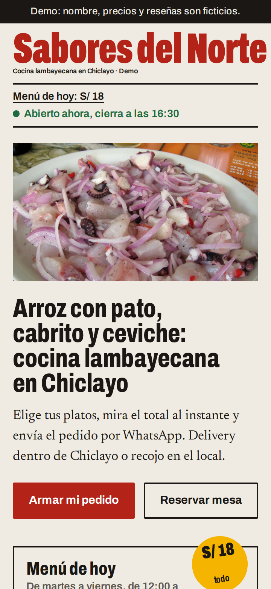
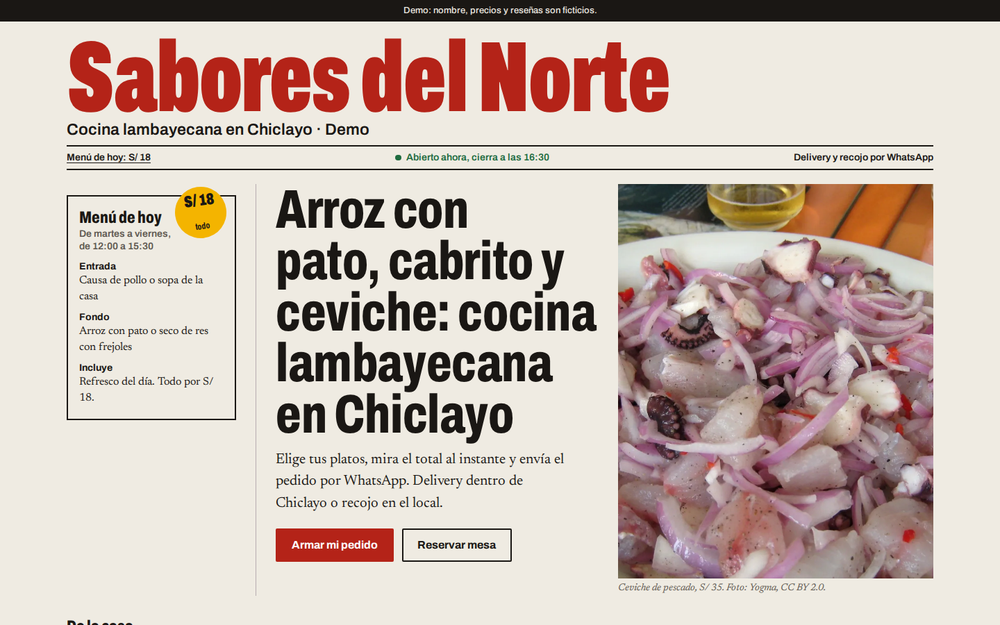
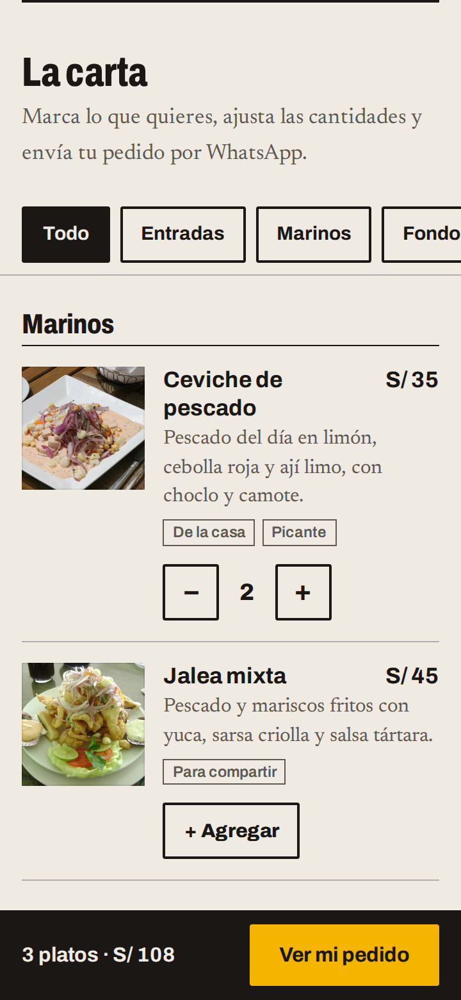
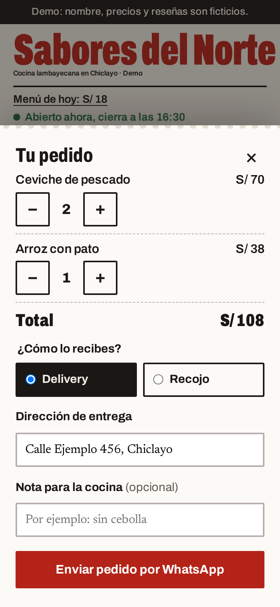
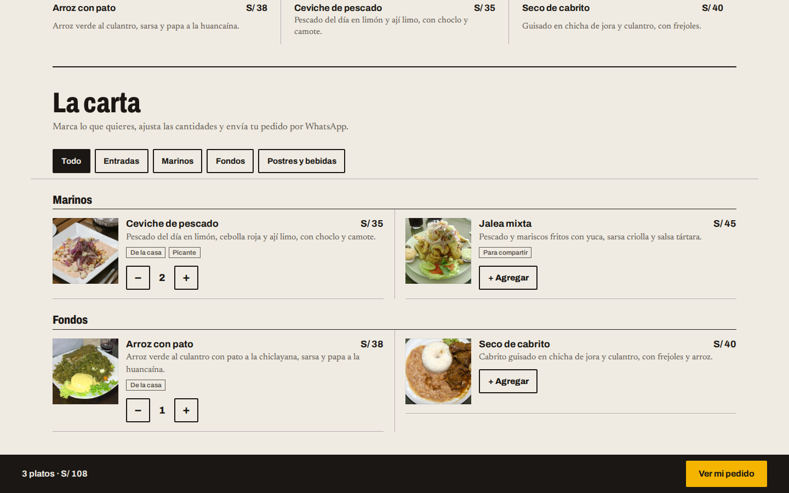

# Brief visual · Restaurante («Sabores del Norte · Demo»)

- **Estado:** esperando aprobación de Iván. No se escribe código del rubro hasta entonces.
- **Fecha:** 2026-10-26
- **Maqueta:** [restaurante/maqueta.html](restaurante/maqueta.html) (HTML estático; se ve con `npx vite` o cualquier servidor local desde la raíz del repo)

## Tu revisión en 5 segundos

| Celular 360 px: primera pantalla                    | Escritorio 1440 px: primera pantalla                  |
| --------------------------------------------------- | ----------------------------------------------------- |
|  |  |

| Carta con pedido (360 px)                             | Comanda abierta (360 px)                                  | Carta en escritorio                                     |
| ----------------------------------------------------- | --------------------------------------------------------- | ------------------------------------------------------- |
|  |  |  |

---

## Paso 1 · Referencias reales

`anti-ui-slop` se cargó, pero su servicio de referencias (UIZZE, MCP de pago) **no está conectado**: como prevé el plan, el paso se hizo con webs reales capturadas a mano y con la guía de nicho de `crear-web-como-servicio`. Las capturas de esas webs no se suben al repo (son de terceros).

| Web                                               | Qué hace bien                                                                                                       | Qué no copiamos                                                         |
| ------------------------------------------------- | ------------------------------------------------------------------------------------------------------------------- | ----------------------------------------------------------------------- |
| [Isolina](https://isolina.pe/) (Lima)             | Foto cenital de comida a pantalla completa y las 5 acciones (Reservas, Para recoger, Delivery…) visibles de entrada | La carta no está en la portada: hay que salir a otra página             |
| [La Mar](https://www.lamarcebicheria.com/) (Lima) | «Reservas» fijo en la cabecera, siempre a un toque                                                                  | Video de ambiente sin comida ni precios: bonito pero no ayuda a decidir |
| [Panchita](https://www.panchita.pe/) (Lima)       | En celular, botón fijo abajo «Pedir por delivery»                                                                   | Carrusel + aviso de cookies que tapa media pantalla                     |

**Qué espera ver el cliente** (coinciden las fuentes consultadas: [MeasuringU](https://measuringu.com/?p=508), [Chowly](https://chowly.com/resources/blogs/essential-restaurant-website-features-that-drive-online-orders/), [Toast](https://pos.toasttab.com/uk/blog/on-the-line/which-restaurant-website-features-convert-visitors-into-customers)): carta con precios en la propia página (nunca un PDF), horario y dirección sin buscar, y **un** botón claro para pedir.

**Nuestra oportunidad:** ninguna de las tres muestra platos con precio en la primera pantalla. Aquí el titular, el menú del día con su precio y «Armar mi pedido» están arriba.

## Paso 2 · Concepto y dirección de arte

> **La carta como portada del diario del día:** el menú de hoy es la noticia, los platos de la casa son los titulares y el pedido se imprime como una comanda.

- **Arquetipo 09 Newspaper Editorial**, llevado al **diario popular peruano** y no al broadsheet clásico. `frontend-design` advirtió que «fondo crema + terracota + serif de titular + filetes de periódico» es justo la combinación que hoy delata una página generada por IA. Por eso: titulares en grotesca condensada y gruesa (no serif), tinta roja de imprenta en vez de terracota, amarillo ají como resaltador, y filetes solo donde separan columnas de verdad.
- **Diferencia con la clínica dental (arquetipo 01):** aquí todo es denso, condensado y en columnas con filetes; la clínica irá en una sans redonda y ligera, a una sola columna con mucho aire y radios suaves. Se distinguen a primera vista por tipografía y composición, como pediste.
- **Composición:**
  - _360 px:_ cabecera del diario → línea de fecha (enlace «Menú de hoy: S/ 18» + «Abierto ahora») → foto 16:9 → titular → bajada → los dos botones en una fila. Comida y botón principal caben en la primera pantalla.
  - _1440 px:_ portada en tres columnas — menú de hoy (con sello S/ 18) · titular con botones · foto vertical 4:5 — y debajo la franja «De la casa» con tres platos, como la fila de «más noticias».
- **Momento firma: la comanda.** Al agregar un plato, aparece la barra de pedido y cada línea se «imprime» en un ticket de cocina perforado. Es movimiento que responde a una acción del cliente, no decoración.
- **Sin Three.js ni GSAP en este rubro**, aunque el plan los permite: el arquetipo pide no animar más allá de la lectura, la comida se vende con fotos (no con 3D) y nos ahorramos ~70 KB (GSAP) o ~600 KB (Three.js) contra el presupuesto de LCP. Si quieres un momento 3D igual, se puede discutir, pero lo recomiendo para la barbería o el gimnasio.

## Paso 3 · Sistema visual

`ui-ux-pro-max` confirmó la familia de color (rojo apetitoso + dorado) y sugirió Playfair Display SC + Karla, que descarté por genérica. También descarté Barlow Condensed: la herramienta la asocia al deporte y queda reservada para el gimnasio.

**Paleta** (contraste medido con `core/contraste.js`):

| Token           | Color                      | Uso                                                           | Contraste                                             |
| --------------- | -------------------------- | ------------------------------------------------------------- | ----------------------------------------------------- |
| `fondo`         | `#EFEBE2` papel de diario  | fondo general                                                 | —                                                     |
| `texto`         | `#1A1714` tinta            | texto y filetes                                               | 15.00:1 sobre papel                                   |
| `marca`         | `#B42318` rojo de imprenta | cabecera, botón principal, foco                               | 5.53:1 sobre papel; texto blanco encima 6.57:1        |
| `acento`        | `#F4B400` ají              | sello de precio, botón de la barra, foco sobre fondos oscuros | solo con tinta encima: 9.67:1 (rojo encima: 3.56:1 ✗) |
| gris de columna | `#5E5850`                  | descripciones, metadatos                                      | 5.91:1 sobre papel                                    |
| abierto         | `#1E6B3F`                  | «Abierto ahora»                                               | 5.46:1 sobre papel                                    |

**Tipografía** (autoalojada en el sitio con `@fontsource-variable`, solo latín):

- **Archivo** variable, en ancho condensado (`font-stretch` 62–75 %), peso 800–900: cabecera, titulares, precios (con `tabular-nums`) y controles.
- **Newsreader**, la serif de noticias, para bajadas, descripciones de platos y pies de foto en cursiva; interlineado 1.65.
- Escala: cabecera `clamp(3.4rem, 15.6vw, 9rem)`, titular `clamp(2.35rem, …, 4.9rem)` (`2.1–3rem` en celular), secciones 2–3.25 rem, cuerpo 1.0625 rem.

**Forma:** radio 2 px (botones como sellos), sin sombras salvo la comanda (es la única pieza que flota), grid de 12 columnas de 78 rem como máximo.

**Revisión de `design-system`** (se aplica al construir, en `core/`):

| Hallazgo                                                                     | Cambio                                                                             |
| ---------------------------------------------------------------------------- | ---------------------------------------------------------------------------------- |
| Sobrescribir `--radio-pildora: 2px` haría mentir al nombre                   | Nuevo token `--radio-boton` en el núcleo (por defecto `var(--radio-pildora)`)      |
| El interlineado 1.65 ya tiene token                                          | Usar `--interlineado-texto`                                                        |
| `--regla-columna` es un borde con otro nombre                                | Sobrescribir `--color-borde`                                                       |
| Titulares gigantes y ancho condensado también los usarán barbería y gimnasio | Subir `--texto-display` y `--ancho-titulos` al núcleo                              |
| «Sobre el ají, solo tinta» vive en la cabeza de alguien                      | Token `--color-sobre-acento`, calculado por `render.js` como `--color-sobre-marca` |

## Paso 4 · Guion de movimiento

Fuentes: `web-animation-design`, `emil-design-engineering` y `make-interfaces-feel-better` (**leídas desde disco**: el plugin `audit-suite` está instalado pero no activo en esta sesión, así que no se pudieron invocar como skills) y el catálogo de efectos de `crear-web-como-servicio` (6.6 capitular, 2.6 scroll nativo, 8.3 navegación activa).

| Elemento                           | Disparador                        | Qué cambia                                                                                         | Duración     | Curva          | Con movimiento reducido |
| ---------------------------------- | --------------------------------- | -------------------------------------------------------------------------------------------------- | ------------ | -------------- | ----------------------- |
| Cabecera y titular                 | carga de la página, una vez       | opacity 0→1 y translateY 8 px→0, titular 80 ms después                                             | 300 ms       | ease-out-quart | sin animación           |
| Botón (presionar)                  | `:active`                         | scale 0.97                                                                                         | 100 ms       | ease-out       | sin animación           |
| Botón (hover)                      | puntero fino                      | color de fondo                                                                                     | 150 ms       | ease           | igual (solo color)      |
| «+ Agregar» → − 2 +                | toque                             | cambio de estado sin animar (lo verás muchas veces)                                                | 0 ms         | —              | igual                   |
| Barra de pedido                    | primer plato agregado             | translateY 110 %→0                                                                                 | 250 ms       | ease-out-quart | aparece sin moverse     |
| Línea de la comanda («se imprime») | abrir la comanda / agregar dentro | opacity + translateY −8 px→0, 60 ms entre líneas                                                   | 200 ms       | ease-out-quart | sin animación           |
| Comanda y velo                     | abrir / cerrar                    | translateY 16 px + opacity; cerrar 20 % más rápido                                                 | 250 / 200 ms | ease-out       | sin animación           |
| Foto del plato (hover)             | puntero fino                      | scale 1.03                                                                                         | 250 ms       | ease           | sin animación           |
| Secciones al hacer scroll          | —                                 | **ninguna**: `frontend-design` señala el «fundido al aparecer» en cada sección como sello genérico | —            | —              | —                       |

**Choque entre skills:** `crear-web-como-servicio` pide no apagar las microinteracciones con movimiento reducido; `web-animation-design` pide apagarlo todo. Sigo la regla del plan («siempre respetando `prefers-reduced-motion`»): con movimiento reducido no se mueve nada; solo cambian colores.

**Presupuesto de rendimiento:**

| Recurso             | Peso estimado                                       | Nota                                           |
| ------------------- | --------------------------------------------------- | ---------------------------------------------- |
| Foto del hero (LCP) | 111 KB WebP                                         | `fetchpriority="high"`, sin lazy               |
| Fuentes             | ~80 KB (2 variables, solo latín)                    | precarga solo de Archivo; `font-display: swap` |
| CSS                 | ~15 KB                                              | un solo archivo                                |
| JS                  | ~10 KB                                              | carrito, filtros y comanda; sin librerías      |
| Meta                | LCP < 2.5 s en 4G, CLS < 0.1, Lighthouse móvil ≥ 90 | si un efecto rompe esto, se quita              |

## Paso 5 · Maqueta

[restaurante/maqueta.html](restaurante/maqueta.html), con capturas reales a 360 px y 1440 px tomadas con Playwright. Chrome _headless_ de Windows no baja de unos 500 px de ancho, y las primeras capturas «de 360» eran falsas.

Iteraciones antes de llegar aquí:

1. El titular quedaba bajo la foto, fuera de la primera pantalla en escritorio → se movió encima.
2. En celular no había comida en la primera pantalla → la foto subió como franja 16:9 y los botones quedaron en una fila.
3. En escritorio la foto seguía bajo el pliegue → portada en tres columnas con foto vertical.
4. Una media query quedaba anulada por una regla base posterior (el error de especificidad que advierte `frontend-design`) → CSS reordenado: base, luego celular, luego escritorio.

## Paso 6 · Revisión experta

**Veredicto: aprobar con cambios. Los cambios ya están aplicados en la maqueta.**

`audit-as-design-eng` (leída desde disco):

| Hallazgo                                               | Corrección aplicada                                                                                  |
| ------------------------------------------------------ | ---------------------------------------------------------------------------------------------------- |
| Foco rojo sobre la barra negra: 2.71:1 (WCAG pide 3:1) | En superficies oscuras el foco pasa a ají: 9.67:1                                                    |
| Colores sueltos (`#951d14`, `#1e6b3f`, `#fff`)         | Tokens `--marca-presionada`, `--abierto`, `--sobre-marca`                                            |
| Modo oscuro sin decidir                                | Diseño de papel solo claro, declarado con `color-scheme: light` para que el navegador no lo invierta |
| Estados sin diseñar                                    | Definidos abajo; sus textos los escribe `ux-copy` en la etapa 5                                      |

`design-critique`:

| Hallazgo                                                                   | Corrección aplicada                                                                                                            |
| -------------------------------------------------------------------------- | ------------------------------------------------------------------------------------------------------------------------------ |
| «Chiclayo, martes» quedaría fijo al construir y sería falso los otros días | Se quitó; en su lugar el enlace «Menú de hoy: S/ 18», el gancho más fuerte al mediodía, que en celular quedaba bajo el pliegue |
| En la comanda no se podían cambiar cantidades ni dejar indicaciones        | Controles − / + por línea y «Nota para la cocina (opcional)»                                                                   |
| Línea de fecha de 3 renglones en celular                                   | 2 renglones                                                                                                                    |

**Estados de la función estrella** (se construyen y se prueban con `npm run test:teclado`):

| Estado                        | Qué se ve                                                                                                     |
| ----------------------------- | ------------------------------------------------------------------------------------------------------------- |
| Carta sin pedido              | Cada plato con «+ Agregar»; sin barra de pedido; el botón flotante de WhatsApp en su sitio                    |
| Con pedido                    | − cantidad + por plato; barra «3 platos · S/ 108 · Ver mi pedido»; el botón flotante sube para no taparla     |
| Comanda vacía (se quitó todo) | Mensaje y botón «Volver a la carta»; el envío queda deshabilitado                                             |
| Error                         | Delivery sin dirección: error junto al campo y foco en él                                                     |
| Enviado                       | «Abrimos WhatsApp con tu pedido listo. Solo falta enviarlo.» El pedido no se borra, por si hay que reenviarlo |
| Sin JavaScript                | Carta completa con precios + enlace directo a WhatsApp (no hay carrito)                                       |

## Para tu aprobación

1. **Concepto y arquetipo:** diario popular (Archivo condensada + Newsreader, rojo de imprenta + ají) en vez del broadsheet crema y terracota.
2. **Sin Three.js ni GSAP** en este rubro; el momento firma es la comanda.
3. **Cambios al núcleo** que salen de `design-system`: `--radio-boton`, `--texto-display`, `--ancho-titulos`, `--color-sobre-acento`.
