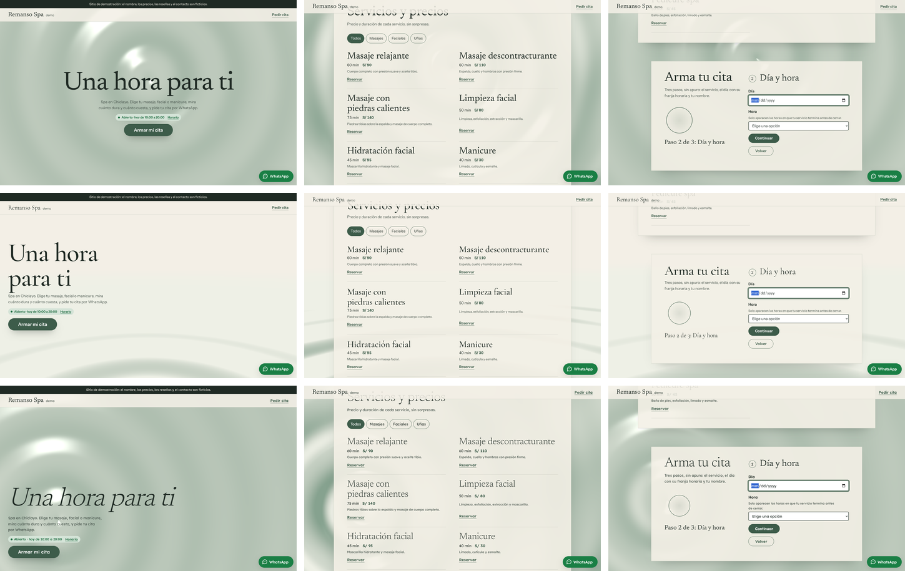
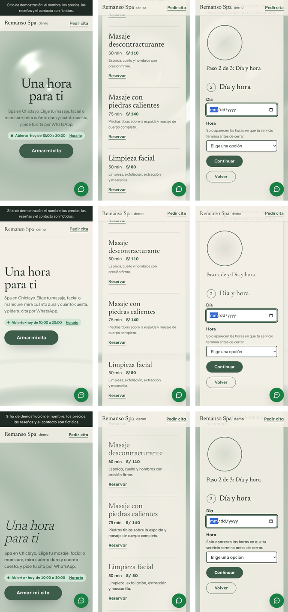
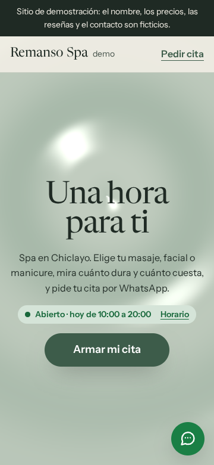
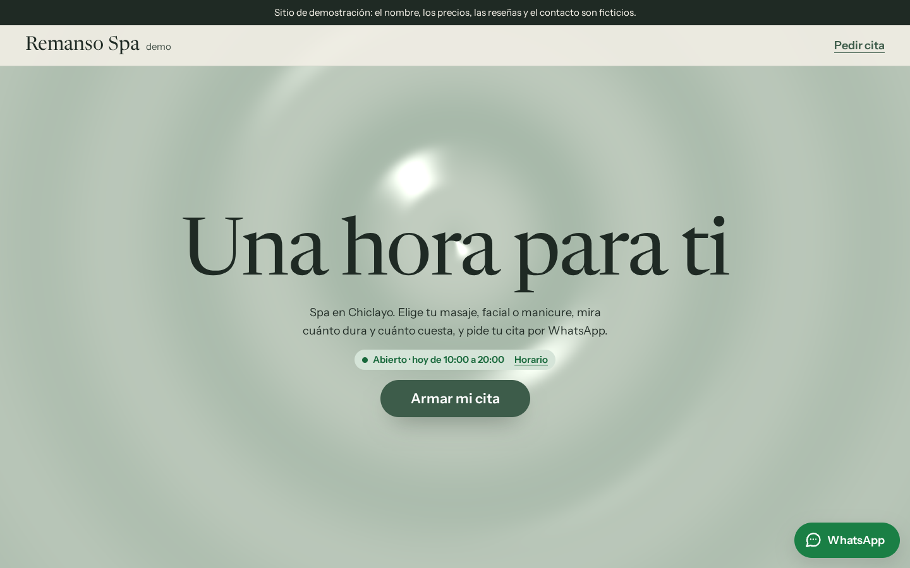
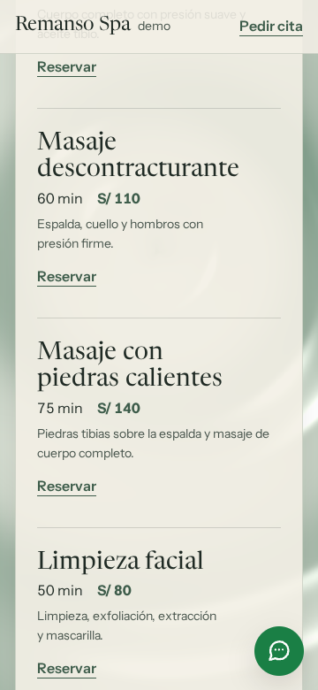
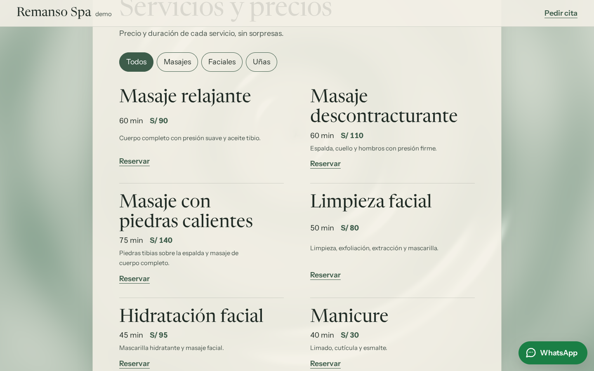
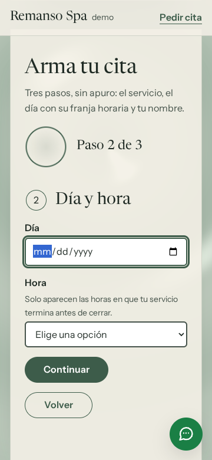
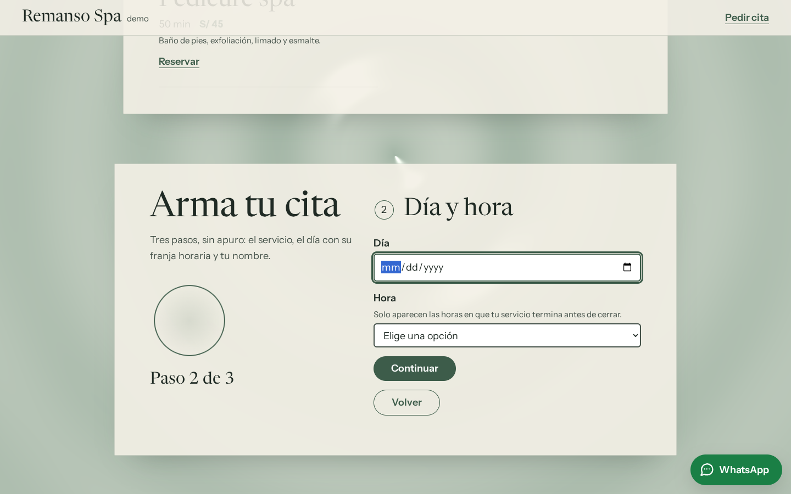

# Brief visual · Spa y estética · «Agua quieta» («Remanso Spa · Demo»)

- **Estado:** pasos 1 a 6 hechos y construido en `spa/`. **Dirección elegida: A «Superficie»** (modo autónomo; ver [docs/PROGRESO.md](../PROGRESO.md)).
- **Fecha:** 2026-10-27
- **Nombre de demo:** «Remanso» (agua quieta de un río). Una búsqueda web no mostró ningún spa con ese nombre en Chiclayo. Igual conviene confirmarlo en Google Maps antes de mostrarlo a un prospecto.
- **Identidad** ([identidad.md](identidad.md)): «Agua quieta».
  - Agua a pantalla completa en la que flotan los textos.
  - Componentes propios: la cita al ritmo de la respiración y el comparador antes/después.
- **Función estrella:** armar la cita paso a paso. Servicio (o paquete) → día y franja → nombre. La cita sale por WhatsApp.
- **Datos:** todos ficticios y marcados como demo:
  - las terapeutas son «de demostración»;
  - las reseñas son de demostración;
  - las imágenes del comparador son dibujos de agua, no resultados.

## Paso 1 · Referencias

**Lo que resuelve la página.** Este paso no revisó las webs de los prospectos del plan (Epilare, SPELLO, Talentosspa, Vital Spa); queda pendiente antes de mostrarles la demo. El plan pide calma, precios claros y llegar a la cita. Lo que el cliente pregunta antes de ir es **cuánto dura, cuánto cuesta y si hay hora el día que puede**. Por eso:

- la carta muestra minutos y precio juntos;
- la cita solo ofrece las franjas en que el servicio termina antes de cerrar.

**El comparador antes/después:**

- **Lo que pide el plan:** un comparador de fotos de clientes.
- **Lo que tiene la demo:** el componente funcionando con dos dibujos de agua (agitada y quieta). La nota dice que son imágenes de demostración y no resultados reales.
- **Por qué:** con fotos de stock de personas sería fabricar resultados. El negocio real pone las fotos de sus clientes, con permiso.
- **Dónde vive:** el componente está en el núcleo (`core/componentes/comparador.js`), para que lo use también la clínica dental cuando tenga fotos reales.

**Inmersión:**

- **Qué se toma:** del cromo de la barbería, una superficie que reacciona al scroll.
- **Qué cambia:** el material es agua y el ritmo es otro. La barbería se agita en cortes secos; aquí el agua se agita a mitad de camino y vuelve a quedar quieta al llegar a la cita.

## Paso 2 · Tres direcciones con storyboard

**Cómo se hizo:** las 3 son variantes de la misma página real, con el contenido de `spa/negocio.json` y el mismo shader de agua en 3 encuadres. Se capturaron con `npm run control -- spa <a|b|c>`. Las variantes no elegidas ya no están en el código, pero sus capturas quedan aquí.

| Dirección          | Concepto                                                  | Escena                                             | Tipografía                           |
| ------------------ | --------------------------------------------------------- | -------------------------------------------------- | ------------------------------------ |
| **A · Superficie** | El agua vista desde arriba; el titular flota en el centro | Anillos que salen de detrás del titular            | Newsreader + Instrument Sans         |
| **B · Horizonte**  | El agua llega hasta el fondo; el titular, en el horizonte | Superficie en perspectiva que se funde con la sala | Cormorant Garamond + Instrument Sans |
| **C · Gota**       | Todo a la izquierda, junto a una gota que cae abajo       | Anillos que salen de la esquina                    | Newsreader cursiva fina + Lexend     |

| Dirección | Inicio · mitad · función estrella (1440 px)               | 360 px                                                  |
| --------- | --------------------------------------------------------- | ------------------------------------------------------- |
| A, B y C  |  |  |

Cuadros sueltos: `control/spa/a/`, `b/` y `c/`, con `1-inicio`, `2-mitad` y `3-estrella` a 360 y 1440 px.

### Control de exigencias de los storyboards

Las 3 variantes pasan lo medible a 360 y 1440 px. Los datos están en `control/spa/<variante>/control.json`.

**Qué se midió en cada exigencia:**

- **1:** en la primera pantalla aparecen el nombre (en la cabecera), el titular, «Abierto · hoy de 10:00 a 20:00» (martes 13:00) con el enlace «Horario», y «Armar mi cita».
- **2:** el titular «Una hora para ti» tiene 4 palabras. Los títulos de sección tienen 5 palabras o menos.
- **3:** la escena cubre el 100 % y está viva.
- **5:** cada variante usa una sola familia de titulares.

**Una corrección antes de comparar:**

- **Problema:** en la primera medición el agua casi no se veía (un salvia plano), así que la exigencia 3 fallaba a ojo.
- **Cambio:** se subió la amplitud de las ondas y el contraste entre el agua honda y el reflejo.

**El juicio** (exigencias 3 y 4, mirando las hojas):

- **A:** los anillos salen de detrás del titular y lo rodean: el texto flota en el agua, como pide la identidad.
- **B:** en perspectiva, el agua se aclara hacia el horizonte y casi se confunde con el fondo. Solo se ve abajo.
- **C:** la gota en la esquina funciona, pero la cursiva fina se acerca al restaurante y deja la portada con menos agua a la vista.

### Elección

| Criterio (1 a 5)                                                         | A · Superficie | B · Horizonte | C · Gota                         |
| ------------------------------------------------------------------------ | -------------- | ------------- | -------------------------------- |
| Exigencias 1, 2 y 5 (medidas)                                            | 5              | 5             | 5                                |
| Exigencia 3: inmersión y «textos que flotan en el agua»                  | 5              | **2**         | 4                                |
| Exigencia 4: componentes del rubro (cita que respira, comparador, carta) | 5              | 5             | 5                                |
| Identidad distinta de los otros rubros                                   | 4              | 4             | 3 (cursiva, como el restaurante) |
| Costo de rendimiento                                                     | 5              | 4             | 5                                |
| **Total**                                                                | **24**         | 20            | 22                               |

**Elegida: A «Superficie».**

- **Cumple la identidad al pie de la letra:** el texto flota en el agua.
- **Se diferencia de la clínica dental y de la barbería,** que también centran la portada, por el material: agua sin objetos, sin placa y sin piezas.

---

## Paso 3 · Sistema visual

- **Tema** (en `negocio.json`):
  - fondo arena clara `#f3efe6`;
  - texto `#1f2a24`;
  - marca salvia oscuro `#3d5c4a` (6.5:1 sobre el fondo; el texto blanco encima, 7.4:1);
  - arena `#e6dcc8` (resumen de la cita y regalo).
- **Agua:**
  - salvia hondo `#86a28f`;
  - reflejo `#eef0e6`.
  - El texto que va directo sobre el agua (titular y bajada) usa el color de texto: 5.4:1 aun en la parte más honda.
- **Texto secundario:** `#45524a` (7.2:1). Solo va sobre las hojas, nunca directo sobre el agua.
- **Hojas de papel arena:** `rgb(243 239 230 / 0.9)`, con radio de 2 px y una sombra larga y suave. Flotan sobre el agua y cada una tiene su propio ancho.
- **Tipografía:**
  - Newsreader (titulares, 400–500, tamaño óptico de display): 25 KB.
  - Instrument Sans (texto, 400–700): 23 KB.
  - Las dos se recortan al español con `npm run fuentes` y tienen respaldo ajustado.
- **Forma:** la única píldora es el llamado, como una piedra lisa. También son píldoras los filtros y los botones de la cita, que son controles.

## Paso 4 · Guion de movimiento

Ritmo de la identidad: **el de una respiración lenta**. Entradas largas que se posan, nada rebota (`sine.out`, `cubic-bezier(0.45, 0, 0.55, 1)`).

| Elemento                                                          | Disparador                    | Duración y curva                                          | Movimiento reducido          |
| ----------------------------------------------------------------- | ----------------------------- | --------------------------------------------------------- | ---------------------------- |
| El agua se agita a mitad de camino y vuelve a quedar quieta       | scroll hasta la cita          | ligado al scroll, con inercia                             | sin 3D: queda la imagen fija |
| Anillo que respira junto al paso de la cita                       | siempre (CSS, solo transform) | 8 s por respiración, curva «respira»                      | anillo quieto                |
| Títulos que suben 36 px desde el agua (GSAP, sin opacidad)        | el título entra al 90 %       | 1,2 s, `sine.out`                                         | sin animación                |
| Los servicios se posan uno tras otro, apenas girados (GSAP)       | la carta entra al 85 %        | 1 s, 90 ms entre servicios, `sine.out`                    | sin animación                |
| El comparador se abre y vuelve al medio para mostrar que se mueve | el comparador entra al 70 %   | 2 × 1,1 s, `sine.inOut`; se cancela si la persona lo toca | sin animación                |
| «Armar mi cita» sube 3 px                                         | hover con mouse               | 400 ms, curva «respira»                                   | sin animación                |

**Carga del 3D (ADR 008):**

1. Imagen fija `img/agua-*.webp` (de 3 a 6 KB), en encuadre horizontal y vertical.
2. Three.js y GSAP llegan con `import()` cuando la página está libre.
3. Nada de eso llega con movimiento reducido, ahorro de datos, poca memoria o sin WebGL2.

**Escena:**

- Es un solo plano con un shader propio: unas pocas ondas por píxel, sin texturas ni luces.
- Quieta, no se redibuja.
- En celular se dibuja al 70 %.

## Paso 5 · Hero vivo (la página construida)

- **Videos:**
  - [recorrido-360.mp4](control/spa/recorrido-360.mp4)
  - [recorrido-1440.mp4](control/spa/recorrido-1440.mp4)
- **Verla en el navegador:** en la terminal de Ubuntu, `npm run build && npm run preview`; luego abre http://localhost:4173/prototipos-web-chiclayo/spa/.

| Cuadro               | 360 px                              | 1440 px                              |
| -------------------- | ----------------------------------- | ------------------------------------ |
| 1 · Inicio           |    |    |
| 2 · Mitad del scroll |     |     |
| 3 · Función estrella |  |  |

## Paso 6 · Revisión, Control final y medición

**Correcciones de la revisión y de las pruebas:**

- **La bajada iba en gris sobre el agua:** daba 2.96:1 en la parte honda. Ahora usa el color de texto (5.4:1).
- **`data-paso` repetido:** la sección de la cita marcaba el paso actual con el mismo atributo que los pasos del formulario. La prueba de teclado lo encontró, y ahora se llama `data-paso-actual`.
- **La muestra animada del comparador le movía el corte a la persona:** pasaba si la persona lo tocaba antes de que llegara la animación. Ahora la muestra se cancela en cuanto alguien enfoca o toca el control.
- **«Paso 2 de 3: Día y hora» repetía el nombre del paso:** el título del formulario ya lo dice. Queda «Paso 2 de 3».
- **En celular el anillo de respiración empujaba el formulario hacia abajo:** ahora es chico y va al lado del paso.

**Control final** (`npm run control -- spa`): pasa a 360 y 1440 px en las exigencias 1, 2, 3 y 5. La 4 se juzga con la captura:

- **Componentes del rubro:**
  - la cita en 3 pasos con el anillo que respira;
  - la carta de spa con minutos y precio;
  - los paquetes con la tarjeta de regalo;
  - el comparador.
- **Lo que no aparece:**
  - hero partido;
  - par de botones;
  - grilla de 3 tarjetas iguales.
- **El ritmo cambia de sección en sección:**
  - carta en 2 columnas;
  - cita en 2 columnas con el anillo;
  - paquetes con borde lateral;
  - comparador;
  - equipo en línea;
  - horario angosto.

**Pruebas:**

- **`test:teclado`:**
  - el tab inicial;
  - la cita completa con teclado, con el error del paso 1, el lunes cerrado, la franja que no cabe antes de cerrar y el mensaje literal de WhatsApp;
  - «Reservar» un paquete;
  - los filtros con el filtro en la URL;
  - el comparador con el teclado;
  - el estado de horario en 2 horas.
- **Axe:** 0 violaciones.

**Lighthouse 12** (build + preview, mediana de 5):

|            | Rendimiento | Accesibilidad | Buenas prácticas | SEO | LCP    | CLS   | TBT    |
| ---------- | ----------- | ------------- | ---------------- | --- | ------ | ----- | ------ |
| Móvil      | **93**      | 100           | 100              | 100 | 1.36 s | 0.006 | 325 ms |
| Escritorio | 99          | 100           | 100              | 100 | 0.33 s | 0.005 | 98 ms  |

Dentro del presupuesto del ADR 008, sin excepción.
