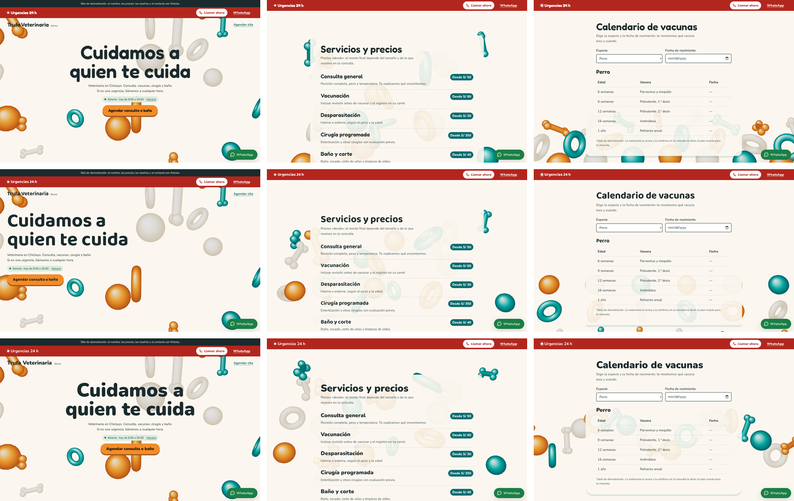
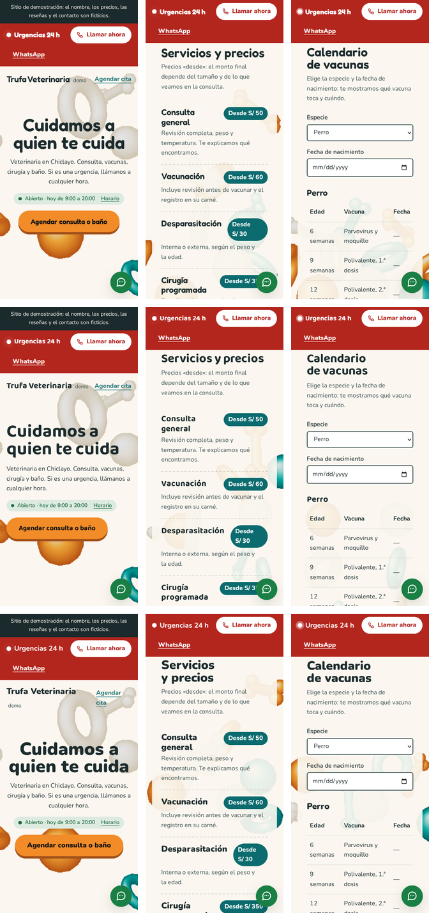
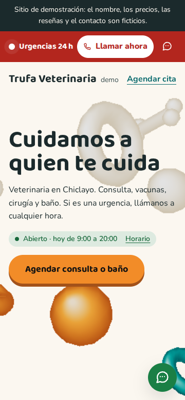
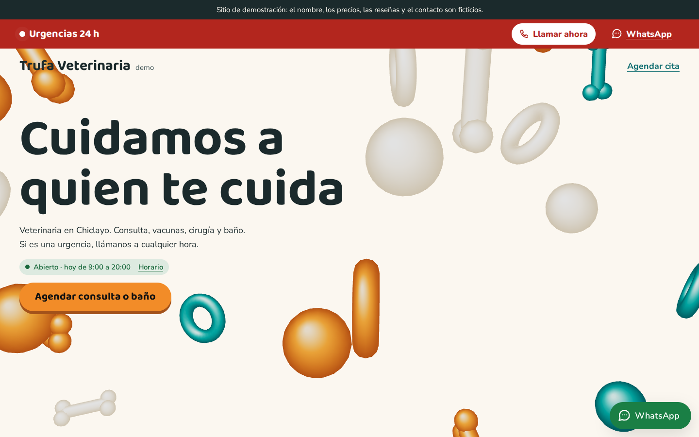
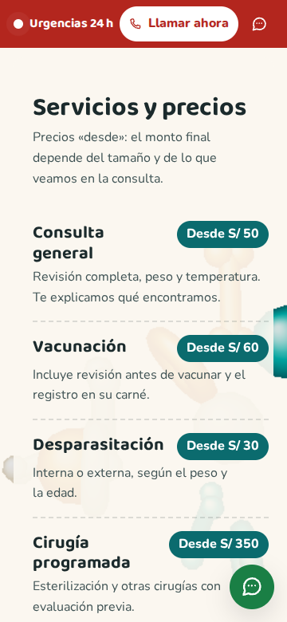
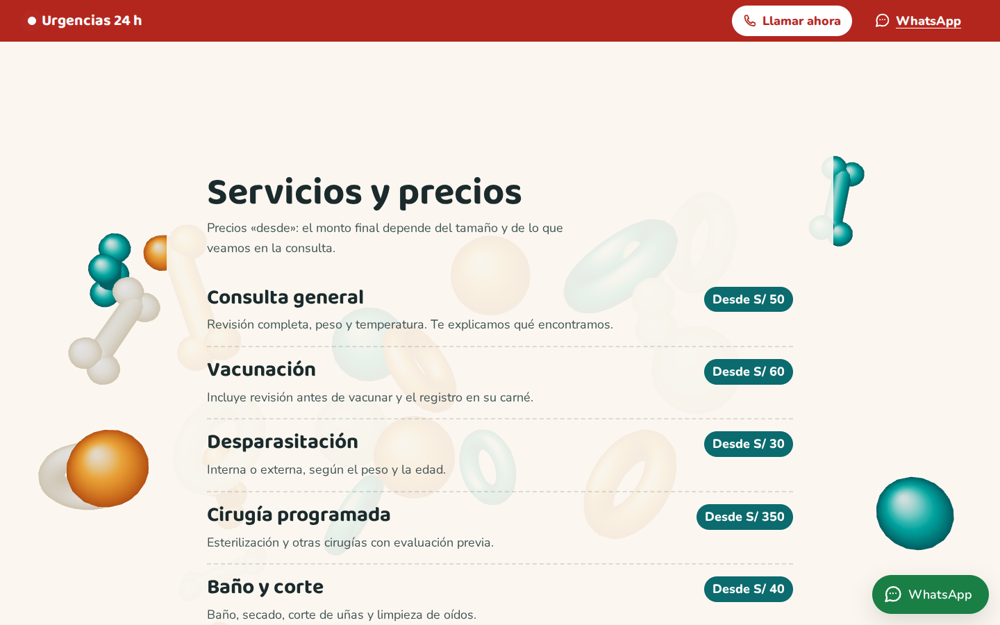
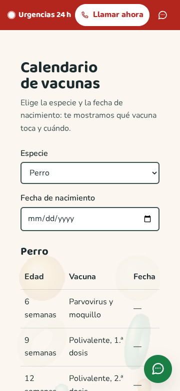
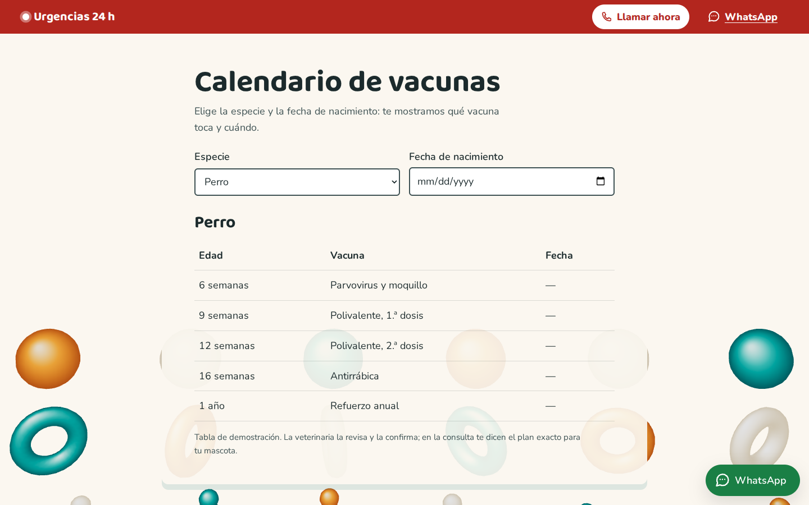

# Brief visual · Veterinaria · «Juego y urgencia» («Trufa Veterinaria · Demo»)

- **Estado:** pasos 1 a 6 hechos y construido en `veterinaria/`. **Dirección elegida: B «Estante»** (modo autónomo; ver [docs/PROGRESO.md](../PROGRESO.md)).
- **Fecha:** 2026-10-27
- **Nombre de demo:** «Trufa» (la nariz del perro). Una búsqueda web no mostró ninguna veterinaria con ese nombre en Chiclayo. Conviene confirmarlo en Google Maps antes de mostrarlo a un prospecto.
- **Identidad** ([identidad.md](identidad.md)): «Juego y urgencia».
  - Formas suaves tipo juguete, mate, que reaccionan al toque y al cursor.
  - Componentes propios: la barra de urgencias que late y el calendario de vacunas por especie.
- **Función estrella:** la barra de urgencias 24 h, fija arriba en toda la página. Tiene un punto que late, «Llamar ahora» (`tel:`) y WhatsApp directo.
- **Datos:** todos ficticios y marcados como demo:
  - el equipo lleva «CMVP 00000 (demo)»;
  - la tabla de vacunas dice que es de demostración y que la confirma la veterinaria;
  - las reseñas son de demostración.

## Paso 1 · Referencias

**Lo que resuelve la página.**

- **Qué falta revisar:** este paso no revisó las webs de los prospectos del plan (Veterinaria San Bernardo, Pets Park, D'Motas). Queda pendiente antes de mostrarles la demo.
- **Qué pide el plan:** que un dueño preocupado encuentre en segundos cómo comunicarse por una urgencia, y que agende consultas y baños en días normales.
- **Las dos situaciones conviven en la página:**
  - la urgencia, en rojo, siempre arriba;
  - lo de rutina (servicios, vacunas, cita), en el tono juguetón de la identidad.

**Lo que no se hace:**

- **No hay plan de vacunas inventado como si fuera oficial:** la tabla está marcada como de demostración. La veterinaria real la revisa y la confirma.
- **No hay colegiaturas inventadas:** el número es «CMVP 00000 (demo)».
- **Los consejos no dan indicaciones médicas:** son cuidados generales que mandan a llamar si algo preocupa.

**Inmersión.** Se toma de la clínica dental la idea de piezas sueltas que se ordenan con el scroll, en otro material y con otro ritmo:

- **Material:** plástico mate de juguete, con 3 colores.
- **Ritmo:** con un saltito.
- **Lo nuevo:** los juguetes **siguen al cursor o al dedo**. Para eso el motor común ganó la opción `puntero`, que redibuja solo mientras el puntero se mueve.

## Paso 2 · Tres direcciones con storyboard

**Cómo se hizo:** las 3 son variantes de la misma página real, con el contenido de `veterinaria/negocio.json` y los mismos juguetes en 3 composiciones finales. Se capturaron con `npm run control -- veterinaria <a|b|c>`. Las variantes no elegidas ya no están en el código, pero sus capturas quedan aquí.

| Dirección        | Concepto                                           | Escena                                     | Tipografía           |
| ---------------- | -------------------------------------------------- | ------------------------------------------ | -------------------- |
| **A · Pelotero** | Portada al centro; los juguetes se amontonan abajo | Una caja de juguetes que se llena          | Fredoka + Nunito     |
| **B · Estante**  | Portada a la izquierda, sin centrar                | Una fila por tipo de juguete, como vitrina | Baloo 2 + Nunito     |
| **C · Rebote**   | Portada al centro, títulos muy gruesos             | Los juguetes forman una onda que rebota    | Nunito en todo (900) |

| Dirección | Inicio · mitad · calendario de vacunas (1440 px)                  | 360 px                                                          |
| --------- | ----------------------------------------------------------------- | --------------------------------------------------------------- |
| A, B y C  |  |  |

Cuadros sueltos: `control/veterinaria/a/`, `b/` y `c/`, con `1-inicio`, `2-mitad` y `3-estrella` a 360 y 1440 px. En el tercer cuadro se ve el calendario de vacunas. La función estrella (la barra de urgencias) está en los 3 cuadros.

### Control de exigencias de los storyboards

Las 3 variantes pasan lo medible a 360 y 1440 px. Los datos están en `control/veterinaria/<variante>/control.json`.

**Qué se midió en cada exigencia:**

- **1:** en la primera pantalla aparecen:
  - el nombre (en la cabecera);
  - el titular;
  - «Abierto · hoy de 9:00 a 20:00» con el enlace «Horario»;
  - «Llamar ahora» en la barra de urgencias.
- **2:** el titular «Cuidamos a quien te cuida» tiene 5 palabras. Los títulos de sección tienen 5 palabras o menos.
- **3:** la escena cubre el 100 % y está viva.
- **5:** cada variante usa una sola familia de titulares.

**Lo que se vio en las hojas y se corrigió para las 3:**

- **Barra de urgencias:** en celular ocupaba 2 líneas. Ahora WhatsApp va como ícono (con su nombre para el lector de pantalla) y la barra entra en una línea.
- **Precios:** «Desde S/ 30» se partía.

**El juicio** (exigencias 3 y 4, mirando las hojas):

- **A:** el montón de juguetes abajo es lo más juguetón, pero la portada centrada repite la composición de la barbería, la clínica dental y el spa.
- **B:** la portada a la izquierda es la única distinta de los otros rubros. La vitrina de juguetes se ve menos que el montón, pero se lee como el estante de una veterinaria.
- **C:** la onda funciona, pero los títulos de 900 se sienten pesados para «cercano», y la portada vuelve a ir centrada.

### Elección

| Criterio (1 a 5)                                                        | A · Pelotero             | B · Estante | C · Rebote           |
| ----------------------------------------------------------------------- | ------------------------ | ----------- | -------------------- |
| Exigencias 1, 2 y 5 (medidas)                                           | 5                        | 5           | 5                    |
| Exigencia 3: juguetes inmersivos que reaccionan                         | 5                        | 4           | 4                    |
| Exigencia 4: componentes del rubro (urgencias que laten, vacunas, cita) | 5                        | 5           | 5                    |
| Identidad distinta de los otros rubros                                  | **3** (portada centrada) | 5           | 3 (portada centrada) |
| Costo de rendimiento                                                    | 5                        | 5           | 5                    |
| **Total**                                                               | 23                       | **24**      | 22                   |

**Elegida: B «Estante».**

- **A la descarté por la composición:** los juguetes amontonados se veían mejor, pero era la cuarta portada centrada seguida.
- **Con B,** la identidad se distingue por la composición y no solo por el color.

---

## Paso 3 · Sistema visual

- **Tema** (en `negocio.json`):
  - fondo crema `#fbf7f0`;
  - texto `#1b2a2c`;
  - marca turquesa oscuro `#0b6b6e` (5.9:1 sobre el fondo; el texto blanco encima, 6.3:1);
  - acento naranja `#f28c28` (el texto oscuro encima, 6.1:1).
- **Urgencia:** rojo `#b3261e` (el texto blanco encima, 6.5:1). Es el único rojo de la página.
- **Texto secundario:** `#3f5254` (7.7:1).
- **Tipografía:**
  - Baloo 2 (titulares, 600–800, redonda y amable): 23 KB.
  - Nunito (texto, 400–800): 24 KB.
  - Las dos se recortan al español con `npm run fuentes`.
- **Forma:**
  - cajas con radio de 12 px y una sombra plana turquesa, como el borde de un juguete de plástico;
  - el llamado es una pelota naranja estirada, con sombra plana debajo;
  - los precios van en etiquetas turquesa.

## Paso 4 · Guion de movimiento

Ritmo de la identidad: **juguetón, con un saltito corto, pero rápido**. La urgencia nunca espera una animación.

| Elemento                                               | Disparador                  | Duración y curva                         | Movimiento reducido          |
| ------------------------------------------------------ | --------------------------- | ---------------------------------------- | ---------------------------- |
| Los juguetes ruedan sueltos y se ordenan en la vitrina | scroll hasta las vacunas    | ligado al scroll, con inercia            | sin 3D: queda la imagen fija |
| Los juguetes se inclinan hacia el cursor o el dedo     | mover el puntero            | inercia de 0.12 por cuadro               | sin 3D                       |
| El punto de urgencias late (CSS, transform y opacidad) | siempre                     | 1,5 s, `ease-out`                        | punto quieto                 |
| Títulos con un saltito (GSAP: escala y desplazamiento) | el título entra al 88 %     | 500 ms, `back.out(2.2)`                  | sin animación                |
| Los servicios caen en su lugar uno tras otro (GSAP)    | la lista entra al 82 %      | 550 ms, 70 ms entre filas, `back.out(2)` | sin animación                |
| Las filas del carné de vacunas se marcan una tras otra | el calendario entra al 75 % | 400 ms, 50 ms, `power2.out`              | sin animación                |
| «Agendar consulta o baño» salta y se inclina 1,5°      | hover con mouse             | 250 ms, curva de rebote                  | sin animación                |

**Carga del 3D (ADR 008):**

1. Imagen fija `img/juego-*.webp` (de 10 a 18 KB), en encuadre horizontal y vertical.
2. Three.js y GSAP llegan con `import()` cuando la página está libre.
3. Nada de eso llega con movimiento reducido, ahorro de datos, poca memoria o sin WebGL2.

**Escena:**

- 24 juguetes (12 en celular): pelotas, aros y huesos.
- Material matcap mate, sin luces ni sombras.
- En celular, el canvas se dibuja al 70 %.

## Paso 5 · Hero vivo (la página construida)

- **Videos:**
  - [recorrido-360.mp4](control/veterinaria/recorrido-360.mp4)
  - [recorrido-1440.mp4](control/veterinaria/recorrido-1440.mp4)
- **Verla en el navegador:** en la terminal de Ubuntu, `npm run build && npm run preview`; luego abre http://localhost:4173/prototipos-web-chiclayo/veterinaria/.

| Cuadro               | 360 px                                      | 1440 px                                      |
| -------------------- | ------------------------------------------- | -------------------------------------------- |
| 1 · Inicio           |    |    |
| 2 · Mitad del scroll |     |     |
| 3 · Vacunas          |  |  |

## Paso 6 · Revisión, Control final y medición

**Correcciones:**

- **Barra de urgencias:** en celular no cabía en una línea. Ahora WhatsApp va como ícono y los textos no se parten.
- **Colores de los juguetes:** eran al azar, y la imagen fija salía distinta de la escena viva. Ahora siguen una secuencia fija.

**Control final** (`npm run control -- veterinaria`): pasa a 360 y 1440 px en las exigencias 1, 2, 3 y 5. La 4 se juzga con la captura:

- **Componentes del rubro:**
  - la barra de urgencias que late;
  - el carné de vacunas con fechas;
  - el sello de colegiatura;
  - la cita que avisa el domingo en la tarde.
- **Lo que no aparece:**
  - hero partido;
  - par de botones;
  - grilla de 3 tarjetas iguales. Los consejos son texto corrido con un punto de color, no tarjetas.

**Pruebas:**

- **`test:teclado`:**
  - «Llamar ahora» es lo primero después del salto;
  - la barra sigue a la vista al bajar hasta el final;
  - el calendario con un cachorro de 9 semanas («La próxima: Polivalente, 1.ª dosis, el 3 de noviembre de 2026.») y «Agendar esta vacuna»;
  - la cita con el error del domingo en la tarde y el mensaje literal de WhatsApp;
  - el estado de horario en 2 horas.
- **Axe:** 0 violaciones.

**Lighthouse 12** (build + preview, mediana de 5):

|            | Rendimiento | Accesibilidad | Buenas prácticas | SEO | LCP    | CLS   | TBT    |
| ---------- | ----------- | ------------- | ---------------- | --- | ------ | ----- | ------ |
| Móvil      | **92**      | 100           | 100              | 100 | 1.36 s | 0.005 | 339 ms |
| Escritorio | 99          | 100           | 100              | 100 | 0.33 s | 0.002 | 88 ms  |

Dentro del presupuesto del ADR 008, sin excepción.
